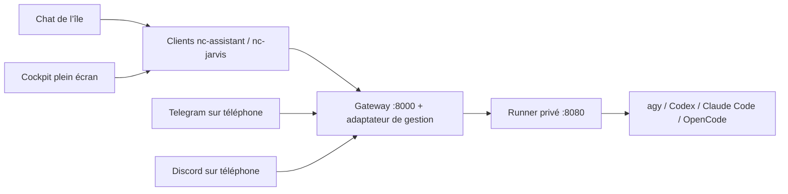

# JARVIS dans le bureau

Le chat de l’île et le cockpit plein écran utilisent la même conversation locale : agrandir, fermer le cockpit
ou revenir à l’île ne relance pas la question et ne perd pas le brouillon. Le logo animé reste celui fourni pour
l’assistant. Les appels passent par `nc-assistant` / `nc-jarvis`, jamais directement de QML vers le runner ou `agy`.

## Accès

- Île : Super + C, bulle de conversation ; bouton d’agrandissement pour le cockpit.
- Chat compact : **Super + Alt + A**, application **JARVIS Chat**, ou `nc-jarvis chat` (voir « Fenêtre de chat ») ; le
  même raccourci referme la fenêtre ouverte (pareil pour le cockpit).
- Cockpit : **Super + Alt + Maj + A**, application **JARVIS**, `nc-jarvis tableau`, le bouton d’agrandissement
  de la fenêtre de chat ou de la page de l’île.
- Retour au chat de l’île : `nc-jarvis ile`. F11 bascule plein écran/fenêtre ; Échap ferme le cockpit.
- **nc-settings → Agents IA (coucou)** : connexion, diagnostic, cockpit et déploiements local/SSH.
- Les commandes `nc-assistant ouvrir`, `chat`, `demander`, `briefing`, `verifier --json` restent compatibles.

Le cockpit natif utilise QtQuick et Quickshell, sans QtQuick.Controls, WebEngine, QtMultimedia ni module de capture.
Sur une installation sans Quickshell utilisable, le chat Kitty et les commandes restent disponibles ; le cockpit
natif demande Quickshell. `nc-jarvis console` donne aussi accès aux lectures de gestion depuis un terminal.
Le code est commun aux distributions prises en charge ; les tests de copie couvrent leurs familles, pas des
installations complètes sur des machines Fedora/Debian distinctes.

La page de l’île reprend l’orbe noir de `pfp.mp4`, ses anneaux cyan et une carte de réglages au-dessus de la
saisie. Le bouton de conversation en haut et le clic sur l’aperçu de réponse ouvrent l’historique complet,
y compris le détail des erreurs. Le badge « Prêt » signifie que la saisie est disponible, pas qu’une connexion
au serveur a été vérifiée. Pendant une demande, le bouton d’envoi indique l’attente ; il ne simule pas une
annulation que l’API ne propose pas. Le micro dicte dans le champ de saisie (voir « Dictée vocale ») ; le
haut-parleur indique qu’il n’y a pas de sortie vocale sur ce client.
L’animation s’arrête quand la page, l’orbe ou le cockpit sont masqués, ainsi qu’en mode sans effets.

## Cockpit

Le cockpit (Super + Alt + Maj + A, `nc-jarvis tableau`, application JARVIS) est une fenêtre Quickshell au style et au
cadrage de la vue des fenêtres et du carrousel : flottante, maximisée sous la barre par la règle Hyprland `jarvis-cockpit`
(`maximize`, sans bordure ni arrondi), le fond d’écran de l’écran flouté et assombri, un cadre
discret, en haut l’emblème, le titre et l’état de la connexion (commandes rondes à droite : actualiser, plein écran,
continuer dans l’île, fermer), puis les pages en pastilles (icône et nom court) et le contenu en colonne centrée ;
boutons et champs en pastilles, cartes aux coins arrondis (`Couleurs`, `Texte`, `Ico`, `AssistantCommande`). F11 passe
en plein écran et en revient. Le même raccourci referme le cockpit. Les pages et leurs actions sont celles d’avant.

## Fenêtre de chat

`JarvisChat.qml` est une petite fenêtre flottante Quickshell (environ 420 × 560 points, centrée par la règle Hyprland
`jarvis-chat`, titre « JARVIS Chat »), dans le style de l’île : orbe, en-tête J.A.R.V.I.S., micro, Markdown et LaTeX.
Le champ de saisie a le focus à l’ouverture, Entrée envoie, Échap ferme (un premier Échap masque les propositions
de commandes). Elle s’ouvre **vierge** à chaque ouverture : les messages plus anciens restent dans l’île et le cockpit,
qui partagent la même liste locale. L’envoi passe par `AssistantEtat` comme dans l’île, donc **la session moteur reste
partagée** avec l’île, le cockpit, Telegram et Discord ; « Nouvelle conversation » envoie le `/reset` existant (session
serveur et mémoire de travail remises à zéro, pour toutes les interfaces) puis vide la fenêtre. Sans Quickshell,
`nc-jarvis chat` ouvre le chat dans un terminal.

C’est une fenêtre ordinaire de Hyprland, sans épinglage forcé : **Super + Ctrl + P** l’épingle sur tous les bureaux comme
n’importe quelle fenêtre (elle reste au-dessus et garde le clavier quand on clique dedans ; la même touche la libère).
L’île ne la ferme pas et ne la masque pas ; Super + Maj + Q la ferme sans toucher à l’île. Le bouton d’agrandissement,
Super + Alt + Maj + A, `nc-jarvis tableau`, l’application JARVIS et la page de l’île donnent toujours le cockpit complet.

## Conversation dans l’île et le cockpit

Les liens Markdown, les URL brutes reconnues par Qt et les liens `file:///…` s’ouvrent au clic
dans l’application associée. Le texte reste sélectionnable ; le survol d’un lien affiche le curseur
de clic. Les URL sont préservées lors de la conversion des formules LaTeX. L’ouverture utilise
[le signal `linkActivated` de QtQuick](https://doc.qt.io/qt-6/qml-qtquick-textedit.html#linkActivated-signal).

Pendant une demande réelle, une bulle **JARVIS ···** apparaît à la fin de la conversation.
Les points s’animent seulement lorsque le chat est visible et les effets activés. La bulle disparaît
à la réponse ou à l’erreur ; elle n’est pas enregistrée dans l’historique et ne simule pas un flux de texte.

Quand l’île est fermée, la pilule affiche le logo animé et **JARVIS réfléchit…** pendant la demande,
puis **JARVIS a répondu** pendant trois secondes après réception d’une réponse réussie. Une erreur ne déclenche
pas cette confirmation. Les alertes ponctuelles et l’enregistrement vidéo gardent leur priorité.
Le bouton d’envoi affiche un indicateur rotatif pendant la requête, sans promettre une annulation distante.
Ces animations respectent la visibilité et le réglage des effets.

Rouvrir le chat affiche sa fin, après le calcul des hauteurs et du retour à la taille du panneau.
Cela vaut aussi après un redimensionnement, une recréation de la page et un retour depuis les réglages.
Le défilement manuel vers les anciens messages reste possible.

Dans les deux interfaces, taper `/` affiche les commandes prises en charge et leur description.
La liste est filtrée à chaque frappe, sans requête réseau ni processus supplémentaire. Les alias
français/anglais sont reconnus ; les noms principaux sont proposés avant les alias.

- **Tab** ou un clic complète la proposition ; les arguments déjà saisis sont conservés.
- **↑ / ↓** change la sélection ; **Entrée** valide cette sélection ou complète un préfixe incomplet.
- **Entrée** sur une commande déjà complète l’envoie normalement ; compléter seul n’envoie rien.
- **Échap** masque d’abord les propositions ; dans le cockpit, un second Échap ferme la fenêtre.

Les tests d’interaction utilisent QtTest uniquement dans le banc de test : ce module n’est pas requis
pour utiliser le bureau. Ils exercent les vrais clics et événements clavier hors écran, ainsi que les
réouvertures, le défilement et l’arrêt des animations masquées.

## Dictée vocale

Dans l’île, le bouton micro (ou l’orbe pendant l’écoute) dicte dans le champ de saisie : un clic démarre
l’enregistrement (badge **Écoute vocale…**), le suivant l’arrête et l’envoie au serveur (**Transcription…**) ;
le texte est ajouté au brouillon, avec le focus et le curseur en fin, sans envoi automatique. Relire, corriger,
puis Entrée. Le script `nc-dictee` (`start`, `stop`, `cancel`, `status`) enregistre en 16 kHz mono avec `parec`,
sinon `pw-record`, sinon `arecord` (PipeWire ou PulseAudio suffisent ; `alsa-utils` à défaut), dans
`$XDG_RUNTIME_DIR`, et envoie le WAV à `POST /api/transcribe` du gateway avec `X-Secret-Key`, sans suivre de
redirection ; l’audio est supprimé après la réponse. Serveur, clé et délai sont ceux de
`~/.config/nc/assistant.conf` (`nc-assistant configurer`) : aucune clé de transcription côté client, le serveur
choisit son moteur (Groq Whisper, OpenAI ou `faster-whisper` local). Une erreur (serveur arrêté, micro coupé,
clé refusée, gateway sans `/api/transcribe` → HTTP 404) s’affiche sous l’orbe, l’écoute s’arrête. Un clic pendant
une demande ou pendant que `nc-dictee` tourne (double clic) est ignoré ; fermer l’île en pleine écoute annule
l’enregistrement. Pas de dictée dans le cockpit plein écran, pas de synthèse vocale.

## Architecture et contrat vérifié

Référence examinée : [JARVIS-BIS](https://github.com/RaphaelBlanc/JARVIS-BIS/tree/8867dd093c43a5e5d3f0a13d3e14600e57edc96a),
notamment [le guide API](https://github.com/RaphaelBlanc/JARVIS-BIS/blob/8867dd093c43a5e5d3f0a13d3e14600e57edc96a/docs/NOCTALIA_API.md)
et le code de `gateway/main.py`, `home-runner/main.py` et `core/tools/dispatcher.py`.
Les anciennes notes `INTEGRATION_NOCTALIA.md` décrivent parfois des routes encore à créer : le code actuel prévaut.



Le chat fonctionne avec l’API d’origine (`POST /api/ask`). Les modules utilisent `POST /api/action`, les rappels
`/api/reminders`, le briefing `/api/briefing`. La gestion complète ajoute un petit adaptateur versionné
`POST /api/nc/manage` **dans le gateway** : il importe l’application originale et conserve ses routes, son cycle
de démarrage, le scheduler et les bots. Le client bureau ne contacte jamais le runner sur 8080.

L’adaptateur relaie uniquement les opérations prévues : modèles, session, conversations/historique, mémoire,
usage, configuration des modules/bots/briefing, état et journaux des services, redémarrages des deux services
utilisateur nommés. Il ne fournit ni chemin HTTP libre vers le runner, ni shell arbitraire.
L’ancien backend reste utilisable pour le chat ; le cockpit indique que l’adaptateur manque au lieu de simuler ses fonctions.

La route upstream `/api/stream` attend la réponse complète avant de la découper. Le client garde donc une attente
réelle puis la réponse complète ; il ne présente pas cette découpe comme une génération de tokens en direct.

## Déployer sur ce PC

Ouvrir **Déploiement → Déployer sur ce PC**, ou :

```sh
nc-jarvis deployer
```

Le terminal propose, séparément :

1. Le téléchargement de la révision examinée dans `~/.local/share/jarvis-bis` et deux venv Python, avec les
   fichiers de dépendances du dépôt d’origine. Python 3.11+, Git et le support `venv` sont nécessaires.
   Sur Debian/Ubuntu, un Python sans `venv` demande notamment le paquet `python3-venv`.
2. Les tokens Telegram/Discord et les IDs autorisés, puis la configuration facultative des modules.
   Les saisies secrètes sont masquées et une valeur vide conserve le token existant.
3. L’installation des services utilisateur `assistant-runner` et `assistant-gateway`, avec sauvegarde des
   unités existantes ; leur activation/démarrage est une proposition distincte.
4. La connexion client locale. Une connexion existante n’est remplacée qu’après choix explicite.

Les services utilisent les chemins réels, les venv du projet et le gateway enrichi `nc_gateway:app` et le runner `nc_runner:app`.
Ils écoutent sur **127.0.0.1:8000** et **127.0.0.1:8080**. Le CLI choisi doit être installé et authentifié sur l’hôte du runner ; cette authentification n’est pas fabriquée par l’intégration.

Le déploiement ne réinitialise pas un checkout existant : il refuse un autre dépôt, une révision différente ou des
modifications suivies. Les fichiers `.env` des composants gardent leurs valeurs propres ; les réglages changés sont
fusionnés. Les clés existantes divergentes demandent une harmonisation manuelle. Un modèle de clé `change_me…`
n’est pas considéré comme une clé à conserver. Les fichiers privés et leurs sauvegardes restent en mode 0600.
Si une unité JARVIS utilisateur pointe déjà vers un autre dossier, le déploiement s’arrête avant de télécharger :
réutiliser ce dossier avec `--path` après vérification du dépôt. Aucune migration automatique vers une base vierge.

## Déployer sur un serveur

Ouvrir **Déploiement → Déployer sur un serveur SSH**, ou :

```sh
nc-jarvis serveur
# équivalent avec la cible déjà choisie :
nc-jarvis deployer --serveur utilisateur@serveur
```

Le client transmet par SSH/SCP un bootstrap contenant seulement du code, **aucun token du PC**, puis lance le
même assistant en mode `server` dans le terminal SSH. Un alias de `~/.ssh/config` peut définir le port ou les
options SSH. Le serveur prépare son propre checkout, ses environnements et ses fichiers privés.
À la fin, il propose d’importer la connexion par SCP et de saisir l’URL HTTPS/VPN du gateway, sans afficher
sa clé. Une connexion client remplacée est sauvegardée. On peut aussi configurer ensuite manuellement
avec `nc-assistant configurer`. Le serveur conserve son fichier de transmission privé dans
`~/.local/state/nc-jarvis/connection.conf` (0600), exclu de l’export du bureau.

Pour que les services utilisateur restent actifs après déconnexion, un administrateur peut devoir activer
le maintien de session avec `loginctl enable-linger`. Un serveur allumé conserve l’accès mobile quand le PC
est éteint ; un backend installé uniquement sur le PC s’arrête quand celui-ci est éteint.

**Une seule instance de gateway par jeu de tokens de bots.** Préparer les deux parcours ne signifie pas démarrer
deux bots Telegram en polling avec le même token. Choisir l’hôte du backend existant pour conserver ses données.
Une installation de la config ou l’ouverture du cockpit ne démarre aucun backend.

Pour l’accès distant du bureau, suivre le [guide réseau JARVIS-BIS](https://github.com/RaphaelBlanc/JARVIS-BIS/blob/8867dd093c43a5e5d3f0a13d3e14600e57edc96a/docs/ACCES_DISTANT.md)
et son `scripts/expose-gateway.sh` : tunnel HTTPS vers le gateway, **jamais vers le runner**. Avec Tailscale et un
bind local, on peut par exemple utiliser Tailscale Serve comme proxy local ; accéder directement à une IP LAN/VPN
exige un bind et un pare-feu adaptés sur le serveur. Les tokens des bots et leurs whitelists restent ceux du backend.

## Matériel local et changement du dépôt upstream

La révision `8867dd0` renomme `render-gateway/` en `gateway/` et supprime le relais WebSocket PC-agent.
Les fonctions matérielles s’exécutent désormais sur **l’hôte de JARVIS**. Un serveur sans session graphique
ne pilote donc pas le bureau de ce PC. L’interface désactive ces actions en mode serveur ; le déploiement
local reste le parcours prévu pour piloter le bureau. La commande historique `nc-jarvis agent` explique
cette limite et n’installe aucun ancien relais.

Un backend existant sur une autre révision n’est pas réinitialisé ni déplacé automatiquement : le déployeur
s’arrête avant modification. Pour migrer une instance, sauvegarder ses données et fichiers privés et examiner
le renommage du dossier gateway, des chemins des services et de leurs venv avant de reprendre. Ne pas créer
un second backend avec les mêmes tokens pour contourner ce contrôle.

## Attente avant une réponse

Le chat de l’île et du cockpit est suivi par `AssistantEtat` : il ne lance plus les hooks Coucou
avant et après chaque réponse. Ces deux sous-processus étaient inutiles depuis la séparation de JARVIS
et d’Agents IA ; chacun pouvait attendre jusqu’à cinq secondes si le suivi se bloquait. Le suivi des
commandes et du chat terminal est conservé. Ce correctif ne prouve pas que le suivi causait une attente
de dix secondes sur une instance particulière.

Pour mesurer une demande réelle sur la machine déjà connectée :

```sh
nc-assistant demander --mesurer "Réponds simplement OK."
```

La réponse reste sur stdout ; stderr contient un objet JSON `timings_ms` : `request_ms` mesure l’appel
HTTP et le décodage de la réponse (réseau, gateway et moteur ensemble), `activity_ms` le suivi Coucou,
et `total_ms` la fonction de requête entière, y compris son verrou. Le démarrage de Python et le rendu
QML ne sont pas compris. Il s’agit d’une seule question, qui rejoint la session partagée, sans répétition
automatique ni appel de diagnostic supplémentaire. Les mesures sont aussi affichées en cas d’échec
de la demande. Elles ne contiennent ni URL, ni clé, ni question. `--timings` est un alias.

AGY conserve son worker et les réglages de session upstream. L’intégration n’impose pas un autre
modèle ou un effort moindre pour masquer la lenteur : vérifier le modèle et la réflexion effectifs
dans les réglages. La route `/api/ask` répond après traitement complet ; l’interface ne dispose pas
d’un vrai flux de génération. Ces mesures ne garantissent donc pas un délai inférieur à dix secondes.

Dans le gateway enrichi `nc_gateway:app`, les appels vers le runner partagent un pool HTTP ouvert
avec le service et fermé après l’arrêt des bots. Cela concerne les quatre moteurs, le bureau et les
bots Telegram/Discord, ainsi que les lectures et réglages du cockpit. Le code upstream garde ses
routes, délais et erreurs ; le pool ne met pas de réponses en cache et ne rejoue pas une demande.
Chaque appel conserve son propre délai, sans modifier ceux des requêtes concurrentes. Les cookies
ne sont pas conservés entre appels. Le pool garde au plus 16 connexions, dont 8 inactives, pendant
60 secondes maximum au repos ; aucun maintien artificiel ni appel périodique n’est ajouté.

Le runner réutilise le gestionnaire des moteurs déjà présent sur la révision récente de JARVIS :
un seul état et un seul verrou, sans envelopper AGY dans un deuxième gestionnaire. Sur l’ancienne
révision prise en charge, l’adaptateur continue de l’installer. Le repérage des terminaux Coucou utilise
un seul instantané Hyprland pour le PID, le shell et la classe, commun à tous les agents suivis.

Les tests HTTP locaux vérifient quatre appels successifs sur une même connexion, l’absence de cache,
les délais concurrents, l’annulation et la fermeture du pool. Ils ne mesurent pas la vitesse d’un vrai
modèle. Les mises à jour copient les adaptateurs, mais n’appliquent pas ces changements à un backend
déjà démarré sans son redémarrage explicite. Un gateway lancé avec `main:app` seul ne bénéficie pas
du pool de `nc_gateway:app`.

## Réglages rapides et moteurs

Le déployeur propose le moteur initial pour le parcours local comme pour SSH ; les choix enregistrés ensuite
dans l’interface restent prioritaires aux redémarrages.

Dans l’île, le bouton **réglages** ouvre le choix du **moteur, modèle et niveau de réflexion**, sans terminal.
**Actualiser** lit les capacités du runner ; **Appliquer** change la session partagée, y compris pour Telegram
et Discord. Les moteurs absents du runner sont grisés. Le bouton **Connexion…** ouvre la configuration privée.
La carte d’accueil présente les familles **Flash, Argon, Opus et Sonnet**, avec **low / medium / high** séparés.
Les boutons utilisent uniquement les identifiants annoncés pour le moteur courant ; les familles et variantes
absentes sont grisées. Plusieurs variantes Flash ne prennent donc plus plusieurs boutons. Aucun modèle n’est
présumé actif avant lecture de la session du serveur. Le catalogue est lu une fois à l’ouverture d’un accueil
sans saisie en cours ; le bouton réglages permet de le charger ou de l’actualiser explicitement.
Un clic prépare le choix ; seule l’action **Appliquer** change la session partagée. Les identifiants qui encodent
l’effort sont alignés sur la variante annoncée correspondante. Fermer les réglages abandonne les choix non
appliqués. Les autres modèles et la saisie d’un identifiant restent accessibles dans les réglages.
L’accueil affiche un statut bref, sans citer la réponse ou l’erreur technique. La conversation garde leur texte
complet et les liens. Aucun dossier fictif n’est affiché.
Les deux adaptateurs doivent être présents : `nc_gateway:app` côté gateway, `nc_runner:app` côté runner.
Une API d’origine reste utilisable pour le chat ; elle n’annonce pas ces nouveaux réglages.

- **agy** conserve le bridge upstream, son worker et ses conversations natives.
- **Codex** utilise `codex exec`, reçoit le prompt sur stdin et lit les réponses JSONL. Les modèles et efforts
  disponibles sont repris du cache local du CLI **sur le runner**, quand il existe. Sinon, saisir l’identifiant
  exact ; l’authentification et les droits du compte sont vérifiés par le CLI lors de la demande.
- **Claude Code** utilise `claude --print --output-format json`, avec `--model` et `--effort`.
- **OpenCode** utilise `opencode run --format json --agent plan`. Un modèle se saisit sous la forme
  `provider/modèle#variante`, conformément au CLI installé. Aucune variante n’est inventée par le client.

Les trois nouveaux moteurs utilisent leurs protections habituelles (Codex en lecture seule, Claude/OpenCode
en mode plan), sans ajout de contournement d’approbation. Ils répondent aux chats ; des actions nécessitant
une autorisation interactive peuvent être refusées. Les outils explicites JARVIS passent toujours par son
catalogue et `/api/action`. Les CLI et leurs comptes doivent être installés/authentifiés sur l’hôte du runner ;
aucune installation de moteur ni copie d’identifiants n’est faite depuis l’île.

Pour ces trois moteurs, JARVIS conserve son propre historique privé, **distinct des sessions CLI personnelles**,
dans `home-runner/.nc-jarvis-engines.json` (0600) : au plus 30 conversations, 20 tours et 32 000 caractères
récents par conversation. La mémoire durable JARVIS est ajoutée à chaque demande. Changer de moteur conserve
les conversations de chacun ; **nouvelle conversation**, reprise et suppression visent le moteur actif.
Les préférences survivent au redémarrage du runner. Les tokens ne sont pas agrégés pour ces moteurs ; l’interface
l’indique. Il ne s’agit pas de sessions natives CLI à contexte illimité.

Les sous-processus sont sérialisés sur le runner, avec timeout et sorties bornées ; leur groupe est arrêté sur
échec ou dépassement. Aucune demande n’est rejouée automatiquement après erreur.

Le visuel de `pfp.mp4` apparaît sur fond noir au-dessus de la saisie : atlas QtQuick, sans dépendance codec.
Son animation s’arrête quand la page est cachée ou quand les effets sont désactivés. Les réglages sont chargés
à l’ouverture manuelle du panneau et à l’application, sans scrutation périodique.

## Gestion et extensions

Le registre du serveur fournit la liste des modules et leurs champs ; les secrets sont fournis en écriture seule,
avec un indicateur « déjà configuré ». Les réglages modifiés sont enregistrés dans les fichiers privés et ne prennent
effet qu’après redémarrage explicite des services. Les IDs de modèles viennent du runner.
Retirer un jeton Telegram/Discord est une action distincte avec confirmation ; vider un champ masqué ne le supprime pas.

Les actions bureau sont décrites dans `~/.local/share/nc-jarvis/actions.json`. Pour ajouter une action ou personnaliser
son formulaire sans perdre la modification lors des mises à jour, créer `~/.config/nc/jarvis-actions.json` :

```json
{
  "shopping": [
    {"id":"clear_done", "label":"Ranger les articles cochés", "fields":[]}
  ]
}
```

Les actions sont fusionnées par ID : un même ID remplace son formulaire, un nouvel ID s’ajoute. Un champ comporte
`key`, `label`, et éventuellement `kind: "number"` ou `secret: true`. Cela décrit une action **déjà implémentée par
le serveur** ; le catalogue n’invente pas une capacité. Un nouveau module peut fournir ses réglages sans exposer
d’action dans le dispatcher : le cockpit le précise. Aucun catalogue distant ne charge du code QML ou Python.
Les champs booléens des réglages ont un bouton activé/désactivé.

Les mutations présentent une confirmation avec leurs paramètres et masquent les valeurs secrètes.
L’envoi passe par stdin JSON : ni token ni paramètres privés dans les arguments du processus.
Le suivi d’activité réutilise les verrous de `nc-claude` ; les requêtes mutantes du même PC sont sérialisées par identité.

## Limites à connaître

- **Session globale actuelle** : le code JARVIS-BIS partage la session moteur entre bureau, Telegram et Discord.
  Changer de modèle, reprendre ou réinitialiser une conversation affecte les autres interfaces. La mémoire durable
  est également partagée. Le cockpit l’indique ; il ne revendique pas une isolation inexistante.
- Le serveur upstream marque les rappels `desktop` comme traités après les avoir seulement journalisés. Le cockpit
  propose donc Telegram/Discord pour une livraison effective ; il n’invente pas un flux d’événements bureau fiable.
- Le verrou du PC ne coordonne pas les autres appareils. Aucune requête n’est rejouée automatiquement après une
  coupure : le moteur peut continuer à la traiter.
- « Bot configuré » indique un token présent, pas la réception vérifiée d’un message mobile.
- **Telegram pendant que le PC est éteint** (polling, `TELEGRAM_WEBHOOK_URL` vide) : le bot upstream jetait les messages
  en attente au démarrage ; l’overlay `nc_telegram.py` les garde et les traite dans l’ordre au démarrage suivant, avec un
  mot au chat (« Reçu pendant l’arrêt à HH:MM ») et le même préfixe devant le texte transmis au modèle (pas devant une
  commande). L’offset Telegram est gardé dans `nc-telegram-offset.json` à côté du `main.py` du gateway
  (`NC_TELEGRAM_OFFSET_FILE` pour le déplacer) : un message déjà traité avant un arrêt brutal n’est pas rejoué. Limite de
  Telegram : un message non récupéré n’est gardé que **24 heures** ; au-delà, rien à rattraper (le journal du gateway dit
  combien ont été rattrapés). En webhook, Telegram rejoue lui-même les messages non livrés quand le serveur revient.
- Les services gérés sont les **services utilisateur du gateway**. Une installation en services système root demande son propre mode de gestion ; le cockpit ne l’assimile pas à `systemctl --user`.
- Le chat local reste borné en RAM (24 messages, 48 000 caractères) et disparaît au redémarrage de l’île.
  Les conversations persistantes du moteur sont consultables séparément dans le cockpit.

## Vérifications

Les tests isolent HOME et l’API : authentification de l’adaptateur, confirmation, chemins autorisés, préservation et
rollback des réglages, masquage des secrets, services à écoute locale, bootstrap SSH sans secrets, échanges du vrai
client avec un faux gateway, états de l’île, copie sur les familles de distributions et navigation QML hors écran.
Les tests de l’adaptateur demandent FastAPI/httpx/python-dotenv dans un **venv de test**, pas sur le client utilisateur.
Le test de contrat opt-in `NC_JARVIS_UPSTREAM=/chemin/JARVIS-BIS` charge le vrai runner et le forward du gateway,
avec HOME temporaire et faux CLI ; il ne contacte ni modèle ni bot.

```sh
python3 -B -m unittest discover -s tests -q
# Avec les dépendances API dans un venv de test :
/path/venv/bin/python -B -m unittest discover -s tests -q
```

Restent nécessaires sur un backend réellement déployé : authentification de chaque CLI, réponse modèle, réception Telegram
et Discord depuis le téléphone, livraison d’un rappel mobile, accès HTTPS/VPN, reconnexion du relais matériel et
redémarrage après boot. Les tests simulés ne constituent pas cette validation en production.

Options des CLI vérifiées dans leur aide installée et les références officielles : [Codex](https://developers.openai.com/codex/cli/reference/), [Claude Code](https://code.claude.com/docs/en/cli-reference), [OpenCode](https://opencode.ai/docs/cli/).

## Rappels du bureau et du téléphone

Dans la conversation de l’île, du cockpit ou du terminal :

```text
/rappel 15m sortir le pain
/rappel bureau 15m sortir le pain
/rappel telegram 2h relire le rapport
/rappel discord 30m réunion
/rappel bureau,telegram 15m sortir le pain
```

Sans plateforme, le rappel vise désormais **ce bureau**. `desktop` et `/remind` sont les alias anglais.
Les délais acceptent `s`, `m`, `h` ou `d`, de 1 seconde à 366 jours. Les rappels bureau ne nécessitent pas de
connexion JARVIS ; ceux du téléphone passent par le gateway et ses bots configurés, comme auparavant.
Une création sur plusieurs plateformes indique séparément les réussites et les échecs, sans nouvelle tentative automatique.

Le bureau utilise `systemd-run --user` et `notify-send` : la notification arrive dans le centre actif de la session
(île Quickshell ou Noctalia). Aucun processus Python ne dort pendant le délai. Un fichier privé dans
`$XDG_RUNTIME_DIR/nc-assistant` conserve le texte jusqu’à la notification ; l’unité ne contient que son identifiant.
L’échéance est en UTC : un rappel échu pendant la veille est déclenché au réveil, sans réveiller lui-même le PC.
Un échec de programmation supprime le fichier ; un échec de notification le conserve pour diagnostic.

Ces timers sont **locaux et temporaires** : ils survivent à la fermeture du chat et au redémarrage de l’île,
mais pas au redémarrage du PC ni à l’arrêt du gestionnaire systemd utilisateur. Pour un rappel durable sur le
téléphone, choisir Telegram ou Discord. La page Rappels du cockpit liste les rappels mobiles du serveur ;
les rappels bureau ne sont pas ajoutés à cette liste distante.

### Rappels récurrents

`/rappel [bureau|telegram|discord] [récurrence] <délai ou heure> <message>`, dans l’île, la fenêtre de chat, le cockpit
et `nc-assistant demander`. Récurrences, en français ou en anglais : `tous les jours`, `en semaine`, `chaque samedi`,
`chaque semaine`, `chaque mois`, `tous les 10 jours`, `toutes les 2 semaines`, `toutes les 3 heures` (ou `chaque heure`).
Avec une récurrence, l’heure est une heure du jour (`08:30`, `8h`, `8h30`) et le rappel est **gardé sur le serveur**
(Telegram ou Discord ; le bureau ne prend qu’un rappel ponctuel, par `systemd-run`). « toutes les 3 heures » sans
heure part dans trois heures. La première échéance est calculée sur le PC (aujourd’hui ou demain, alignée sur le jour
demandé) ; le gateway reprogramme ensuite chaque occurrence (`every:hours:N` est ajouté par l’overlay `nc_telegram.py`,
les autres règles sont celles d’upstream). `/rappels` liste les rappels du serveur avec leur numéro, `/supprimer <numéro>`
en retire un ; sur Telegram, `/rappel`, `/rappels`, `/annuler_rappel` sont les commandes natives du bot, `/supprimer` est
ajouté par l’overlay. La page Rappels du cockpit garde ses formulaires (champ Récurrence : les mêmes mots-clés).

## Alertes de la machine vers Telegram

`nc-reglages → Agents IA → Alertes Telegram` (`ALERTES_TELEGRAM`, non par défaut). `nc-alertes verifier`, lancé toutes
les cinq minutes par `nc-alertes.timer`, envoie par le bot JARVIS (op `notify` de `/api/nc/manage`, aux chats qui ont
déjà écrit au bot) : la batterie passée sous le seuil de l’île (`BATTERIE_ALERTE`, une fois par passage, réarmé en
rechargeant), un service utilisateur `nc-*`, `noctalia`, `assistant-*` ou `hypridle` en échec (une fois par échec), et la
fin d’une mise à jour du système lancée depuis l’île (`nc-paquets` appelle `nc-alertes maj N`). `nc-alertes envoyer
TEXTE` envoie un message libre. Rien n’est envoyé sans le réglage ni sans connexion configurée ; état dans
`~/.local/state/nc/alertes.json`.

## Réglages du PC depuis Telegram

Commande `/nc` (ou `/pc`) du bot, ajoutée par l’overlay, **seulement en déploiement local** (`DEPLOY_MODE=local` : le
gateway tourne sur le PC ; le mode serveur ne pilote pas le bureau), pour les utilisateurs de la liste blanche du bot
(`TELEGRAM_ALLOWED_USER_IDS`). Table fixe de commandes `nc-*` et `powerprofilesctl` du compte qui héberge le gateway,
arguments vérifiés, jamais de shell (`nc-reglages set` valide lui-même les valeurs) :

- `/nc` : état (énergie, batterie, écrans, mises à jour, thème) ; `/nc aide` ;
- `/nc energie [performance|equilibre|eco]`, `/nc theme [sombre|clair]`, `/nc fond` (fond d’écran suivant) ;
- `/nc ecran [pc|miroir|etendre|externe]` : projection ; `pc` et `externe` éteignent un écran, donc demandent
  `/nc oui` dans les deux minutes ;
- `/nc maj` : mises à jour du système en attente (comptées par `nc-paquets` ; la mise à jour elle-même demande ton mot
  de passe dans un terminal, elle ne se lance pas depuis le téléphone) ;
- `/nc reglage CLE [VALEUR]` : lire ou changer un réglage de `nc-reglages` (`nc-reglages liste` pour les clés).

Les mêmes actions forment la section `noctalia` du catalogue `actions.json` (op `noctalia` de `/api/nc/manage` ;
`nc-jarvis requete` avec `tool: noctalia` y passe) : lecture sans confirmation, changement avec. Les commandes qui
touchent l’écran ont besoin de l’environnement de la session Hyprland, importé dans `systemd --user` à l’ouverture de
session.

