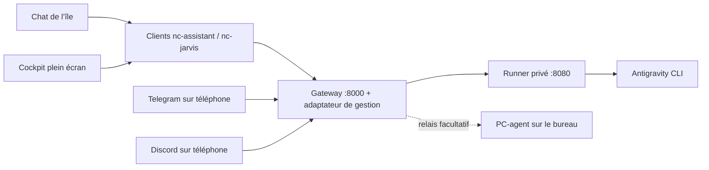

# JARVIS dans le bureau

Le chat de l’île et le cockpit plein écran utilisent la même conversation locale : agrandir, fermer le cockpit
ou revenir à l’île ne relance pas la question et ne perd pas le brouillon. Le logo animé reste celui fourni pour
l’assistant. Les appels passent par `nc-assistant` / `nc-jarvis`, jamais directement de QML vers le runner ou `agy`.

## Accès

- Île : Super + C, bulle de conversation ; bouton d’agrandissement pour le cockpit.
- Cockpit : **Super + Alt + A**, application **JARVIS**, ou `nc-jarvis tableau`.
- Retour au chat de l’île : `nc-jarvis ile`. F11 bascule plein écran/fenêtre ; Échap ferme le cockpit.
- **nc-settings → Agents IA (coucou)** : connexion, diagnostic, cockpit et déploiements local/SSH.
- Les commandes `nc-assistant ouvrir`, `chat`, `demander`, `briefing`, `verifier --json` restent compatibles.

Le cockpit natif utilise QtQuick et Quickshell, sans QtQuick.Controls, WebEngine, QtMultimedia ni module de capture.
Sur une installation sans Quickshell utilisable, le chat Kitty et les commandes restent disponibles ; le cockpit
natif demande Quickshell. `nc-jarvis console` donne aussi accès aux lectures de gestion depuis un terminal.
Le code est commun aux distributions prises en charge ; les tests de copie couvrent leurs familles, pas des
installations complètes sur des machines Fedora/Debian distinctes.

## Architecture et contrat vérifié

Référence examinée : [JARVIS-BIS](https://github.com/RaphaelBlanc/JARVIS-BIS/tree/554bbf077c0b50baa25f61dc53c0c6e434cda0a9),
notamment [le guide API](https://github.com/RaphaelBlanc/JARVIS-BIS/blob/554bbf077c0b50baa25f61dc53c0c6e434cda0a9/docs/NOCTALIA_API.md)
et le code de `render-gateway/main.py`, `home-runner/main.py` et `core/tools/dispatcher.py`.
Les anciennes notes `INTEGRATION_NOCTALIA.md` décrivent parfois des routes encore à créer : le code actuel prévaut.



Le chat fonctionne avec l’API d’origine (`POST /api/ask`). Les modules utilisent `POST /api/action`, les rappels
`/api/reminders`, le briefing `/api/briefing`. La gestion complète ajoute un petit adaptateur versionné
`POST /api/nc/manage` **dans le gateway** : il importe l’application originale et conserve ses routes, son cycle
de démarrage, le scheduler et les bots. Le client bureau ne contacte jamais le runner sur 8080.

L’adaptateur relaie uniquement les opérations prévues : modèles, session, conversations/historique, mémoire,
usage, configuration des modules/bots/briefing, état et journaux des services, redémarrages de trois services
utilisateur nommés. Il ne fournit ni chemin HTTP libre vers le runner, ni shell arbitraire.
L’ancien backend reste utilisable pour le chat ; le cockpit indique que l’adaptateur manque au lieu de simuler ses fonctions.

La route upstream `/api/stream` attend la réponse complète avant de la découper. Le client garde donc une attente
réelle puis la réponse complète ; il ne présente pas cette découpe comme une génération de tokens en direct.

## Déployer sur ce PC

Ouvrir **Déploiement → Déployer sur ce PC**, ou :

```sh
nc-jarvis deployer
```

Le terminal propose, séparément :

1. Le téléchargement de la révision examinée dans `~/.local/share/jarvis-bis` et deux venv Python, avec les
   fichiers de dépendances du dépôt d’origine. Python 3.11+, Git et le support `venv` sont nécessaires.
   Sur Debian/Ubuntu, un Python sans `venv` demande notamment le paquet `python3-venv`.
2. Les tokens Telegram/Discord et les IDs autorisés, puis la configuration facultative des modules.
   Les saisies secrètes sont masquées et une valeur vide conserve le token existant.
3. L’installation des services utilisateur `assistant-runner` et `assistant-gateway`, avec sauvegarde des
   unités existantes ; leur activation/démarrage est une proposition distincte.
4. La connexion client locale. Une connexion existante n’est remplacée qu’après choix explicite.

Les services utilisent les chemins réels, les venv du projet et le gateway enrichi `nc_gateway:app`.
Ils écoutent sur **127.0.0.1:8000** et **127.0.0.1:8080**. Antigravity CLI doit être installé et authentifié
avec `agy login` sur l’hôte du runner ; cette authentification n’est pas fabriquée par l’intégration.

Le déploiement ne réinitialise pas un checkout existant : il refuse un autre dépôt, une révision différente ou des
modifications suivies. Les fichiers `.env` des composants gardent leurs valeurs propres ; les réglages changés sont
fusionnés. Les clés existantes divergentes demandent une harmonisation manuelle. Un modèle de clé `change_me…`
n’est pas considéré comme une clé à conserver. Les fichiers privés et leurs sauvegardes restent en mode 0600.
Si une unité JARVIS utilisateur pointe déjà vers un autre dossier, le déploiement s’arrête avant de télécharger :
réutiliser ce dossier avec `--path` après vérification du dépôt. Aucune migration automatique vers une base vierge.

## Déployer sur un serveur

Ouvrir **Déploiement → Déployer sur un serveur SSH**, ou :

```sh
nc-jarvis serveur
# équivalent avec la cible déjà choisie :
nc-jarvis deployer --serveur utilisateur@serveur
```

Le client transmet par SSH/SCP un bootstrap contenant seulement du code, **aucun token du PC**, puis lance le
même assistant en mode `server` dans le terminal SSH. Un alias de `~/.ssh/config` peut définir le port ou les
options SSH. Le serveur prépare son propre checkout, ses environnements et ses fichiers privés.
À la fin, il propose d’importer la connexion par SCP et de saisir l’URL HTTPS/VPN du gateway, sans afficher
sa clé. Une connexion client remplacée est sauvegardée. On peut aussi configurer ensuite manuellement
avec `nc-assistant configurer`. Le serveur conserve son fichier de transmission privé dans
`~/.local/state/nc-jarvis/connection.conf` (0600), exclu de l’export du bureau.

Pour que les services utilisateur restent actifs après déconnexion, un administrateur peut devoir activer
le maintien de session avec `loginctl enable-linger`. Un serveur allumé conserve l’accès mobile quand le PC
est éteint ; un backend installé uniquement sur le PC s’arrête quand celui-ci est éteint.

**Une seule instance de gateway par jeu de tokens de bots.** Préparer les deux parcours ne signifie pas démarrer
deux bots Telegram en polling avec le même token. Choisir l’hôte du backend existant pour conserver ses données.
Une installation de la config ou l’ouverture du cockpit ne démarre aucun backend.

Pour l’accès distant du bureau, suivre le [guide réseau JARVIS-BIS](https://github.com/RaphaelBlanc/JARVIS-BIS/blob/554bbf077c0b50baa25f61dc53c0c6e434cda0a9/docs/ACCES_DISTANT.md)
et son `scripts/expose-gateway.sh` : tunnel HTTPS vers le gateway, **jamais vers le runner**. Avec Tailscale et un
bind local, on peut par exemple utiliser Tailscale Serve comme proxy local ; accéder directement à une IP LAN/VPN
exige un bind et un pare-feu adaptés sur le serveur. Les tokens des bots et leurs whitelists restent ceux du backend.

## Relais matériel facultatif

Avec un backend distant, **Relier le matériel de ce PC** ou `nc-jarvis agent` prépare un checkout séparé
`~/.local/share/jarvis-bis-pc-agent` et son venv. Il réutilise la connexion privée du client pour ouvrir le WebSocket
sortant `/ws/pc-agent` du gateway. L’installation et le démarrage du service demandent un choix explicite.

Ce relais peut piloter le presse-papiers, les fenêtres et les commandes système du PC. Il est attaché à la session
graphique et n’est jamais activé par `nc-maj`. Activer le module matériel côté serveur reste nécessaire. Les fonctions
matérielles exigent leurs outils (Hyprland, PipeWire, grim, etc.) et le bon environnement de session.

## Gestion et extensions

Le registre du serveur fournit la liste des modules et leurs champs ; les secrets sont fournis en écriture seule,
avec un indicateur « déjà configuré ». Les réglages modifiés sont enregistrés dans les fichiers privés et ne prennent
effet qu’après redémarrage explicite des services. Les IDs de modèles viennent du runner.
Retirer un jeton Telegram/Discord est une action distincte avec confirmation ; vider un champ masqué ne le supprime pas.

Les actions bureau sont décrites dans `~/.local/share/nc-jarvis/actions.json`. Pour ajouter une action ou personnaliser
son formulaire sans perdre la modification lors des mises à jour, créer `~/.config/nc/jarvis-actions.json` :

```json
{
  "shopping": [
    {"id":"clear_done", "label":"Ranger les articles cochés", "fields":[]}
  ]
}
```

Les actions sont fusionnées par ID : un même ID remplace son formulaire, un nouvel ID s’ajoute. Un champ comporte
`key`, `label`, et éventuellement `kind: "number"` ou `secret: true`. Cela décrit une action **déjà implémentée par
le serveur** ; le catalogue n’invente pas une capacité. Un nouveau module peut fournir ses réglages sans exposer
d’action dans le dispatcher : le cockpit le précise. Aucun catalogue distant ne charge du code QML ou Python.
Les champs booléens des réglages ont un bouton activé/désactivé.

Les mutations présentent une confirmation avec leurs paramètres et masquent les valeurs secrètes.
L’envoi passe par stdin JSON : ni token ni paramètres privés dans les arguments du processus.
Le suivi d’activité réutilise les verrous de `nc-claude` ; les requêtes mutantes du même PC sont sérialisées par identité.

## Limites à connaître

- **Session globale actuelle** : le code JARVIS-BIS partage la session moteur entre bureau, Telegram et Discord.
  Changer de modèle, reprendre ou réinitialiser une conversation affecte les autres interfaces. La mémoire durable
  est également partagée. Le cockpit l’indique ; il ne revendique pas une isolation inexistante.
- Le serveur upstream marque les rappels `desktop` comme traités après les avoir seulement journalisés. Le cockpit
  propose donc Telegram/Discord pour une livraison effective ; il n’invente pas un flux d’événements bureau fiable.
- Le verrou du PC ne coordonne pas les autres appareils. Aucune requête n’est rejouée automatiquement après une
  coupure : le moteur peut continuer à la traiter.
- « Bot configuré » indique un token présent, pas la réception vérifiée d’un message mobile.
- Les services gérés sont les **services utilisateur du gateway**. Une installation en services système root ou
  Render demande son propre mode de gestion ; le cockpit ne l’assimile pas à `systemctl --user`.
- Le chat local reste borné en RAM (24 messages, 48 000 caractères) et disparaît au redémarrage de l’île.
  Les conversations persistantes du moteur sont consultables séparément dans le cockpit.

## Vérifications

Les tests isolent HOME et l’API : authentification de l’adaptateur, confirmation, chemins autorisés, préservation et
rollback des réglages, masquage des secrets, services à écoute locale, bootstrap SSH sans secrets, échanges du vrai
client avec un faux gateway, états de l’île, copie sur les familles de distributions et navigation QML hors écran.
Les tests de l’adaptateur demandent FastAPI/httpx/python-dotenv dans un **venv de test**, pas sur le client utilisateur.

```sh
python3 -B -m unittest discover -s tests -q
# Avec les dépendances API dans un venv de test :
/path/venv/bin/python -B -m unittest discover -s tests -q
```

Restent nécessaires sur un backend réellement déployé : authentification `agy`, réponse modèle, réception Telegram
et Discord depuis le téléphone, livraison d’un rappel mobile, accès HTTPS/VPN, reconnexion du relais matériel et
redémarrage après boot. Les tests simulés ne constituent pas cette validation en production.
