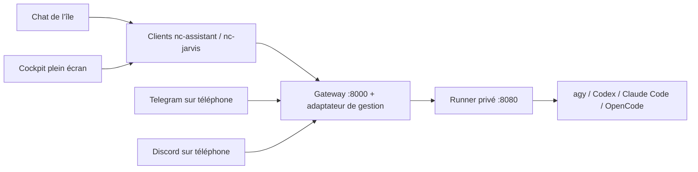

# JARVIS dans le bureau

Le chat de l’île et le cockpit plein écran utilisent la même conversation locale : agrandir, fermer le cockpit
ou revenir à l’île ne relance pas la question et ne perd pas le brouillon. Le logo animé reste celui fourni pour
l’assistant. Les appels passent par `nc-assistant` / `nc-jarvis`, jamais directement de QML vers le runner ou `agy`.

## Accès

- Île : Super + C, bulle de conversation ; bouton d’agrandissement pour le cockpit.
- Chat compact : **Super + Maj + A**, application **JARVIS Chat**, ou `nc-jarvis chat` (voir « Fenêtre de chat ») ; le
  même raccourci, fenêtre déjà ouverte, la ramène sur ton bureau si elle est ailleurs (ou masquée), la met devant si
  elle est derrière, et la masque si elle est active ; masquée, elle garde sa forme (rangée avec Super + V ou libre) et
  sa conversation. Pareil pour le cockpit et la fenêtre des réglages.
- Cockpit : **Super + Ctrl + A**, application **JARVIS**, `nc-jarvis tableau`, le bouton d’agrandissement
  de la fenêtre de chat ou de la page de l’île.
- Retour au chat de l’île : `nc-jarvis ile`. F11 bascule plein écran/fenêtre ; Échap ferme le cockpit.
- **nc-settings → Agents IA (coucou)** : connexion, diagnostic, cockpit et déploiements local/SSH.
- Les commandes `nc-assistant ouvrir`, `chat`, `demander`, `briefing`, `verifier --json` restent compatibles.

Le cockpit natif utilise QtQuick et Quickshell, sans QtQuick.Controls, WebEngine, QtMultimedia ni module de capture.
Sur une installation sans Quickshell utilisable, le chat Kitty et les commandes restent disponibles ; le cockpit
natif demande Quickshell. `nc-jarvis console` donne aussi accès aux lectures de gestion depuis un terminal.
Le code est commun aux distributions prises en charge ; les tests de copie couvrent leurs familles, pas des
installations complètes sur des machines Fedora/Debian distinctes.

La page de l’île reprend l’orbe noir de `pfp.mp4`, ses anneaux cyan et une carte de réglages au-dessus de la
saisie. Le bouton de conversation en haut et le clic sur l’aperçu de réponse ouvrent l’historique complet,
y compris le détail des erreurs. Le badge « Prêt » signifie que la saisie est disponible, pas qu’une connexion
au serveur a été vérifiée. Pendant une demande, le bouton d’envoi indique l’attente ; il ne simule pas une
annulation que l’API ne propose pas. Le micro dicte dans le champ de saisie (voir « Dictée vocale ») ; le
haut-parleur indique qu’il n’y a pas de sortie vocale sur ce client.
L’animation s’arrête quand la page, l’orbe ou le cockpit sont masqués, ainsi qu’en mode sans effets.

## Cockpit

Le cockpit (Super + Ctrl + A, `nc-jarvis tableau`, application JARVIS) est une fenêtre Quickshell classique, avec
la bordure, l’arrondi et les marges de Hyprland : la règle `jarvis-cockpit` la met flottante et `nc/automatismes.lua` la
place à l’ouverture à la taille d’une fenêtre rangée seule sous la barre (zone réservée de l’écran moins la marge des
fenêtres ; une fenêtre maximisée par Hyprland n’aurait pas les marges). Fond uni ; en haut l’emblème, le titre et l’état de la connexion (commandes rondes à
droite : actualiser, continuer dans l’île, fermer), puis les pages en pastilles (icône et nom court) et le contenu en
colonne centrée ; boutons et champs en pastilles, cartes aux coins arrondis (`Couleurs`, `Texte`, `Ico`,
`AssistantCommande`). Super + F la passe en plein écran et la rend, comme toute fenêtre. Super + V la range parmi tes
fenêtres comme les autres ; le même raccourci la ramène, la met devant ou la masque (voir plus haut). Les pages et leurs actions sont celles d’avant.

## Fenêtre de chat

`JarvisChat.qml` est une petite fenêtre flottante Quickshell (environ 420 × 560 points, centrée par la règle Hyprland
`jarvis-chat`, titre « JARVIS Chat »), dans le style de l’île : orbe, en-tête J.A.R.V.I.S., micro, Markdown et LaTeX.
Le champ de saisie a le focus à l’ouverture, Entrée envoie, Échap ferme (un premier Échap masque les propositions
de commandes). Elle s’ouvre **vierge** à chaque ouverture : les messages plus anciens restent dans l’île et le cockpit,
qui partagent la même liste locale. L’envoi passe par `AssistantEtat` comme dans l’île, donc la fenêtre, l’île et le
cockpit de ce PC parlent dans **la même session**. Avec AGY (révision `64523e5`), chaque PC a la sienne, Telegram et
Discord aussi ; avec Claude Code, Codex ou OpenCode, une seule session reste partagée par tous (voir « Réglages rapides
et moteurs »). « Nouvelle conversation » envoie le `/reset` existant (session serveur et mémoire de travail remises à
zéro : celle de ce PC avec AGY, celle de tout le monde sinon) puis vide la fenêtre. Sans Quickshell,
`nc-jarvis chat` ouvre le chat dans un terminal.

C’est une fenêtre ordinaire de Hyprland, sans épinglage forcé : **Super + Ctrl + P** l’épingle sur tous les bureaux comme
n’importe quelle fenêtre (elle reste au-dessus et garde le clavier quand on clique dedans ; la même touche la libère).
L’île ne la ferme pas et ne la masque pas ; Super + Maj + Q la ferme sans toucher à l’île. Le bouton d’agrandissement,
Super + Ctrl + A, `nc-jarvis tableau`, l’application JARVIS et la page de l’île donnent toujours le cockpit complet.

## Conversation dans l’île et le cockpit

Les liens Markdown, les URL brutes reconnues par Qt et les liens `file:///…` s’ouvrent au clic
dans l’application associée. Le texte reste sélectionnable ; le survol d’un lien affiche le curseur
de clic. Les URL sont préservées lors de la conversion des formules LaTeX. L’ouverture utilise
[le signal `linkActivated` de QtQuick](https://doc.qt.io/qt-6/qml-qtquick-textedit.html#linkActivated-signal).

Pendant une demande réelle, une bulle **JARVIS ···** apparaît à la fin de la conversation.
Les points s’animent seulement lorsque le chat est visible et les effets activés. La bulle disparaît
à la réponse ou à l’erreur ; elle n’est pas enregistrée dans l’historique et ne simule pas un flux de texte.

Quand l’île est fermée, la pilule affiche le logo animé et **JARVIS réfléchit…** pendant la demande,
puis **JARVIS a répondu** pendant trois secondes après réception d’une réponse réussie. Une erreur ne déclenche
pas cette confirmation. Les alertes ponctuelles et l’enregistrement vidéo gardent leur priorité.
Le bouton d’envoi affiche un indicateur rotatif pendant la requête, sans promettre une annulation distante.
Ces animations respectent la visibilité et le réglage des effets.

Rouvrir le chat affiche sa fin, après le calcul des hauteurs et du retour à la taille du panneau.
Cela vaut aussi après un redimensionnement, une recréation de la page et un retour depuis les réglages.
Le défilement manuel vers les anciens messages reste possible.

Dans les deux interfaces, taper `/` affiche les commandes prises en charge et leur description.
La liste est filtrée à chaque frappe, sans requête réseau ni processus supplémentaire. Les alias
français/anglais sont reconnus ; les noms principaux sont proposés avant les alias.

- **Tab** ou un clic complète la proposition ; les arguments déjà saisis sont conservés.
- **↑ / ↓** change la sélection ; **Entrée** valide cette sélection ou complète un préfixe incomplet.
- **Entrée** sur une commande déjà complète l’envoie normalement ; compléter seul n’envoie rien.
- **Échap** masque d’abord les propositions ; dans le cockpit, un second Échap ferme la fenêtre.

Les tests d’interaction utilisent QtTest uniquement dans le banc de test : ce module n’est pas requis
pour utiliser le bureau. Ils exercent les vrais clics et événements clavier hors écran, ainsi que les
réouvertures, le défilement et l’arrêt des animations masquées.

## Dictée vocale

Dans l’île, le bouton micro (ou l’orbe pendant l’écoute) dicte dans le champ de saisie : un clic démarre
l’enregistrement (badge **Écoute vocale…**), le suivant l’arrête et l’envoie au serveur (**Transcription…**) ;
le texte est ajouté au brouillon, avec le focus et le curseur en fin, sans envoi automatique. Relire, corriger,
puis Entrée. Le script `nc-dictee` (`start`, `stop`, `cancel`, `status`) enregistre en 16 kHz mono avec `parec`,
sinon `pw-record`, sinon `arecord` (PipeWire ou PulseAudio suffisent ; `alsa-utils` à défaut), dans
`$XDG_RUNTIME_DIR`, et envoie le WAV à `POST /api/transcribe` du gateway avec `X-Secret-Key`, sans suivre de
redirection ; l’audio est supprimé après la réponse. Serveur, clé et délai sont ceux de
`~/.config/nc/assistant.conf` (`nc-assistant configurer`) : aucune clé de transcription côté client, le serveur
choisit son moteur (Groq Whisper, OpenAI ou `faster-whisper` local). `nc-dictee` lui dit aussi la langue parlée
(`?language=`) : `fr` ou `en` selon `NC_LANGUE` ou le réglage Langue, sinon la langue du système (`de`, `es`…), sinon
`auto` (Whisper devine). C’est nécessaire depuis `64523e5`, où le serveur transcrit en français si on ne lui dit rien
(`WHISPER_LANGUAGE="fr"` dans son `.env`, à mettre à `auto` pour l’ancien comportement) ; `3d1c6b6` lit le même
paramètre. Ce serveur souffle aussi « Transcription en français. » à Whisper, quelle que soit la langue : en anglais,
la transcription reste bonne, mais un mot peut parfois sortir en français. Une erreur (serveur arrêté, micro coupé,
clé refusée, gateway sans `/api/transcribe` → HTTP 404) s’affiche sous l’orbe, l’écoute s’arrête. Un clic pendant
une demande ou pendant que `nc-dictee` tourne (double clic) est ignoré ; fermer l’île en pleine écoute annule
l’enregistrement. Pas de dictée dans le cockpit plein écran, pas de synthèse vocale.

## Architecture et contrat vérifié

Référence examinée : [JARVIS-BIS](https://github.com/RaphaelBlanc/JARVIS-BIS/tree/8867dd093c43a5e5d3f0a13d3e14600e57edc96a),
notamment [le guide API](https://github.com/RaphaelBlanc/JARVIS-BIS/blob/8867dd093c43a5e5d3f0a13d3e14600e57edc96a/docs/NOCTALIA_API.md)
et le code de `gateway/main.py`, `home-runner/main.py` et `core/tools/dispatcher.py`.
Les anciennes notes `INTEGRATION_NOCTALIA.md` décrivent parfois des routes encore à créer : le code actuel prévaut.



Le chat fonctionne avec l’API d’origine (`POST /api/ask`). Les modules utilisent `POST /api/action`, les rappels
`/api/reminders`, le briefing `/api/briefing`. La gestion complète ajoute un petit adaptateur versionné
`POST /api/nc/manage` **dans le gateway** : il importe l’application originale et conserve ses routes, son cycle
de démarrage, le scheduler et les bots. Le client bureau ne contacte jamais le runner sur 8080.

L’adaptateur relaie uniquement les opérations prévues : modèles, session, conversations/historique, mémoire,
usage, configuration des modules/bots/briefing, état et journaux des services, redémarrages des deux services
utilisateur nommés. Il ne fournit ni chemin HTTP libre vers le runner, ni shell arbitraire.
L’ancien backend reste utilisable pour le chat ; le cockpit indique que l’adaptateur manque au lieu de simuler ses fonctions.

La route upstream `/api/stream` attend la réponse complète avant de la découper. Le client garde donc une attente
réelle puis la réponse complète ; il ne présente pas cette découpe comme une génération de tokens en direct.

## Déployer sur ce PC

Ouvrir **Déploiement → Déployer sur ce PC**, ou :

```sh
nc-jarvis deployer
```

Le terminal propose, séparément :

1. Le téléchargement de la révision examinée dans `~/.local/share/jarvis-bis` et deux venv Python, avec les
   fichiers de dépendances du dépôt d’origine. Python 3.11+, Git et le support `venv` sont nécessaires.
   Sur Debian/Ubuntu, un Python sans `venv` demande notamment le paquet `python3-venv`.
2. Les tokens Telegram/Discord et les IDs autorisés, puis la configuration facultative des modules.
   Les saisies secrètes sont masquées et une valeur vide conserve le token existant.
3. L’installation des services utilisateur `assistant-runner` et `assistant-gateway`, avec sauvegarde des
   unités existantes ; leur activation/démarrage est une proposition distincte.
4. La connexion client locale. Une connexion existante n’est remplacée qu’après choix explicite.

Les services utilisent les chemins réels, les venv du projet et le gateway enrichi `nc_gateway:app` et le runner `nc_runner:app`.
Ils écoutent sur **127.0.0.1:8000** et **127.0.0.1:8080**. Le CLI choisi doit être installé et authentifié sur l’hôte du runner ; cette authentification n’est pas fabriquée par l’intégration.

Le déploiement ne réinitialise pas un checkout existant : il refuse un autre dépôt, une révision différente ou des
modifications suivies. Les fichiers `.env` des composants gardent leurs valeurs propres ; les réglages changés sont
fusionnés. Les clés existantes divergentes demandent une harmonisation manuelle. Un modèle de clé `change_me…`
n’est pas considéré comme une clé à conserver. Les fichiers privés et leurs sauvegardes restent en mode 0600.
Si une unité JARVIS utilisateur pointe déjà vers un autre dossier, le déploiement s’arrête avant de télécharger :
réutiliser ce dossier avec `--path` après vérification du dépôt. Aucune migration automatique vers une base vierge.

## Déployer sur un serveur

Ouvrir **Déploiement → Déployer sur un serveur SSH**, ou :

```sh
nc-jarvis serveur
# équivalent avec la cible déjà choisie :
nc-jarvis deployer --serveur utilisateur@serveur
```

Le client transmet par SSH/SCP un bootstrap contenant seulement du code, **aucun token du PC**, puis lance le
même assistant en mode `server` dans le terminal SSH. Un alias de `~/.ssh/config` peut définir le port ou les
options SSH. Le serveur prépare son propre checkout, ses environnements et ses fichiers privés.
À la fin, il propose d’importer la connexion par SCP et de saisir l’URL HTTPS/VPN du gateway, sans afficher
sa clé. Une connexion client remplacée est sauvegardée. On peut aussi configurer ensuite manuellement
avec `nc-assistant configurer`. Le serveur conserve son fichier de transmission privé dans
`~/.local/state/nc-jarvis/connection.conf` (0600), exclu de l’export du bureau.

Pour que les services utilisateur restent actifs après déconnexion, un administrateur peut devoir activer
le maintien de session avec `loginctl enable-linger`. Un serveur allumé conserve l’accès mobile quand le PC
est éteint ; un backend installé uniquement sur le PC s’arrête quand celui-ci est éteint.

**Une seule instance de gateway par jeu de tokens de bots.** Préparer les deux parcours ne signifie pas démarrer
deux bots Telegram en polling avec le même token. Choisir l’hôte du backend existant pour conserver ses données.
Une installation de la config ou l’ouverture du cockpit ne démarre aucun backend.

Pour l’accès distant du bureau, suivre le [guide réseau JARVIS-BIS](https://github.com/RaphaelBlanc/JARVIS-BIS/blob/8867dd093c43a5e5d3f0a13d3e14600e57edc96a/docs/ACCES_DISTANT.md)
et son `scripts/expose-gateway.sh` : tunnel HTTPS vers le gateway, **jamais vers le runner**. Avec Tailscale et un
bind local, on peut par exemple utiliser Tailscale Serve comme proxy local (Tailscale est recommandé : un tunnel
Cloudflare gratuit coupe les requêtes au bout de 100 secondes, HTTP 524 ; les adresses Tailscale `100.64.0.0/10`
et `*.ts.net` ne déclenchent pas d'avertissement « HTTP en clair », la liaison étant chiffrée) ; accéder directement à une IP LAN/VPN
exige un bind et un pare-feu adaptés sur le serveur. Les tokens des bots et leurs whitelists restent ceux du backend.

**Un gateway exposé n'a qu'une protection : sa `SECRET_KEY`.** La confirmation des actions sensibles de l'interface
(`confirmed` de `/api/nc/manage` : éteindre un écran, changer un réglage du PC) protège d'un clic accidentel, pas d'un
programme qui connaît la clé : celui-ci peut tout demander. Garde la clé longue et privée, ne l'écris dans aucun
dépôt, et change-la si elle a pu fuiter (dans les `.env` du backend, puis `nc-assistant configurer` sur chaque PC).

## Passer un serveur déjà installé à la révision validée

La révision validée est `4ecc57a`. Par rapport à `f522291`, elle envoie `confirm_unavailable` quand elle ne peut pas
relayer la demande à distance (au lieu d'un refus automatique), contrôle `run_shell` et le nom exact du PC pour les
commandes et les écritures de fichiers, impose `desktop:…` et des listes blanches de modes sur la route de gestion
(l'overlay reprend ces contrôles et la fin de session des nœuds au reset), borne ses sessions AGY à 64 et garde un
client HTTP par boucle d'événements, quatre au plus (l'overlay en fait des emprunts de son pool, jamais un second
pool). `f522291`, `aae5b9b` et `64523e5` restent acceptées.

`f522291`, par rapport à `aae5b9b`, relaie dans Telegram la confirmation à distance de
`nc-noeud` (voir « Confirmer à distance ») : le code se tape en réponse au message même de la demande, et un chat qui
attend déjà un code ne reçoit pas la suivante. Elle laisse 80 s aux actions des nœuds (`nc-noeud` en garde 60 pour
« Autoriser ») et garde un seul client HTTP dans son gateway (l’overlay le fait passer par son pool de connexions).
`aae5b9b` avait ajouté à `64523e5` le délai dans chaque demande d’action, `ENABLE_NODE_EXEC` vérifié aussi pour les
commandes relayées, et le MCP `jarvis-nodes` (voir « Laisser JARVIS piloter ce PC »).
`64523e5` avait ajouté à `3d1c6b6` (choix en boutons, délais de 600 s, dictée côté serveur, accès Tailscale) :

- **une session par PC avec AGY** : le serveur range chaque conversation sous une clé, `desktop:` suivi du nom du PC
  (le `client_id` que `nc-assistant` envoie déjà), `telegram:…` ou `discord:…` pour les bots. Avec nos autres moteurs
  (Claude Code, Codex, OpenCode), rien ne change : une seule session partagée ;
- **la dictée en français par défaut** (`WHISPER_LANGUAGE`, voir « Dictée vocale ») ;
- **des nœuds plus sûrs** pour `nc-noeud` : la clé seulement dans l’en-tête, `ws://` refusé vers un hôte public,
  les commandes coupées par défaut (voir « Laisser JARVIS piloter ce PC »).

Le déployeur installe la révision validée (`4ecc57a`) sur un nouveau serveur, et accepte un serveur resté sur une
révision validée plus ancienne (`f522291`, `aae5b9b`, `64523e5` et `3d1c6b6` compris), mais ne change jamais celle d'un serveur déjà
installé. Pour le faire, sur la machine du backend (dossier par défaut `~/.local/share/jarvis-bis`) :

```bash
git -C ~/.local/share/jarvis-bis fetch --depth=1 origin 4ecc57a8351fee610185b699b12c4b15092fe5ff
git -C ~/.local/share/jarvis-bis checkout --detach FETCH_HEAD
```

puis relance `nc-jarvis deployer` (ou `nc-jarvis deployer --serveur utilisateur@serveur`) depuis le PC : il réécrit
les unités, l'overlay en tête (à faire de toute façon depuis la correction DEP-01), et redémarre les services.

Ne lance pas `scripts/switch-to-unified.sh` ni `deploy.sh setup` du dépôt du serveur : ils écoutent sur toutes les
interfaces (0.0.0.0), sans l'overlay de noctalia-config, et remplacent ses `.env`.

N’installe pas à la main les révisions intermédiaires `1ae55f3`, `8ff25c3` ou `4d279b6` : elles passent une clé de
session à des fonctions que l’overlay d’avant `64523e5` ne connaissait pas, et chaque question finit en erreur 500.
Le déployeur les refuse. Mets d’abord noctalia-config à jour, puis passe directement à `4ecc57a`. Il refuse aussi
les révisions entre `aae5b9b` et `f522291` (`d1b0280` à `9f4cdeb`) : la première version du relais à distance y
remplaçait la demande en attente.

## Matériel local et changement du dépôt upstream

La révision `8867dd0` renomme `render-gateway/` en `gateway/` et supprime le relais WebSocket PC-agent.
Les fonctions matérielles s’exécutent désormais sur **l’hôte de JARVIS**. Un serveur sans session graphique
ne pilote donc pas le bureau de ce PC. L’interface désactive ces actions en mode serveur ; le déploiement
local reste le parcours prévu pour piloter le bureau. La commande historique `nc-jarvis agent` explique
cette limite et n’installe aucun ancien relais. Pour qu’un serveur distant agisse quand même sur ce PC, avec ta
confirmation, voir la section suivante.

Un backend existant sur une autre révision n’est pas réinitialisé ni déplacé automatiquement : le déployeur
s’arrête avant modification. Pour migrer une instance, sauvegarder ses données et fichiers privés et examiner
le renommage du dossier gateway, des chemins des services et de leurs venv avant de reprendre. Ne pas créer
un second backend avec les mêmes tokens pour contourner ce contrôle.

## Laisser JARVIS piloter ce PC

`nc-noeud` fait de ce PC un « nœud » de JARVIS : le serveur peut lui demander une action (musique, notification,
capture, fichier, commande…). Il remplace le client `clients/node_agent.py` du serveur, qui exécute tout sans
demander.

- **Coupé par défaut.** Pour l’activer : nc-reglages → Intelligence artificielle → « Laisser JARVIS piloter ce PC »
  (cela démarre ou arrête le service `nc-noeud.service`). Si l’IA du bureau est coupée (`IA_MODE=non`), tout est
  refusé.
- **Ta confirmation** pour ce qui compte : une commande, lire ou écrire un fichier, une capture d’écran, écrire le
  presse-papiers. Une personne dit toujours « Autoriser » : il n’existe pas de mode sans confirmation pour ces
  actions. Par défaut, une carte s’affiche dans l’île ; sans l’île, une notification à boutons. Musique,
  notification, lecture du presse-papiers, verrouillage et liste d’un dossier passent seuls (réglable). Les clés SSH
  et GPG, les mots de passe et données des navigateurs, les identifiants (gh, Claude, Codex, Gemini, OpenCode, cloud,
  messageries), le serveur JARVIS local, le démarrage automatique et les shells restent interdits, même confirmés ;
  les fichiers qui lancent des commandes à ta place (Hyprland, uwsm, l’île, `~/.config/nc`, `~/.local/bin`, lanceurs
  d’applis, git, kitty) se lisent mais ne s’écrivent pas. Couper l’IA (`IA_MODE=non`) ou le pilotage pendant
  l’attente l’emporte : les deux sont relus juste avant d’exécuter. Chaque demande est notée dans
  `~/.local/state/noctalia-config/noeud.log` (0600), avec sa décision et d’où elle vient (`autorisé (écran)`,
  `refusé (distance)`…), l’empreinte sha256 de la commande ou du contenu entier, les caractères cachés écrits en
  clair, jamais un secret.
- **Délais : jusqu’à 60 s depuis `aae5b9b` (`f522291` annonce 80 s : 60 pour confirmer, 17 pour exécuter), 12 s ou
  17 s avec un serveur plus ancien.** Le serveur abandonne de son
  côté et répond « échec » à JARVIS ; un « Autoriser » arrivé après ne doit rien faire. Depuis `aae5b9b`, chaque trame
  d’action porte son délai :
  `{"type":"action","req_id":"…","action":"exec","params":{"command":"uname -a","timeout":60.0},"timeout":65.0}`.
  Sur ce délai moins 3 s, `nc-noeud` laisse les trois quarts pour confirmer, 60 s au plus, et garde le reste pour
  exécuter, 15 s au plus : `min(timeout − 3 − min(15, (timeout − 3) / 4), 60)`, arrondi à la seconde inférieure.
  Une trame de 65 s laisse 47 s pour confirmer (taper le code sur le téléphone prend 25 à 40 s) et 15 s pour
  exécuter ; 80 s en laisse 60 et 17 ; 35 s en laisse 24 et 8. Le champ n’est pris que s’il est un nombre
  fini (pas un booléen), positif et d’au plus une heure ; sinon, ou s’il manque, les délais connus : 12 s pour un
  fichier, une capture ou le presse-papiers, 17 s pour une action relayée ou une commande (3 s sous le délai le plus
  court des révisions anciennes, qui n’annoncent rien). Un délai annoncé sous 6 s ne laisse pas le temps de te
  demander : refus direct. L’exécution elle-même s’arrête aussi 3 s avant l’abandon du serveur : une commande
  autorisée au bout de 23 s sur 35 a 9 s pour tourner, puis elle est tuée ; s’il reste moins d’1 s, rien n’est fait.
  Avec un serveur qui n’annonce pas de délai dans la trame, une commande a donc au plus 17 s, confirmation comprise.
  Un « Autoriser » tardif affiche « Trop tard » et le serveur reçoit un seul refus. Le délai annoncé est accepté
  jusqu’à une heure ; une trame très longue (par exemple 3 600 s) laisse donc une exécution d’autant, mais une commande
  reste de toute façon bornée à 120 s (son propre `timeout`, plafonné), et lire ou écrire un fichier est quasi instantané.
- **La clé secrète part seulement dans l’en-tête** `X-Secret-Key`, jamais dans l’adresse. La connexion est en
  `wss://`, ou en `ws://` seulement vers un réseau privé ou Tailscale (le serveur `64523e5` refuse lui aussi `ws://`
  vers un hôte public).
- **Côté serveur**, dans son `.env` : `ENABLE_TOOL_NODES=1` active le module des nœuds, et `ENABLE_NODE_EXEC=1`
  autorise les commandes de l’outil des nœuds (coupées par défaut depuis `64523e5`). Avant `4ecc57a`,
  `ENABLE_NODE_EXEC=0` ne coupait pas tout (`run_shell` passait par `/api/node/{id}/action`, et `{id}` acceptait un
  bout du nom du PC) : corrigé à `4ecc57a`. Sur une révision plus ancienne, la vraie protection reste sur ce PC : `nc-noeud` demande
  toujours ton accord et refuse sans réponse.
- **`TELEGRAM_ALLOWED_USER_IDS` est obligatoire** (ton identifiant Telegram ; jamais `ALLOW_ALL_USERS=1`) : le relais
  à distance n’envoie la demande qu’à ces personnes, et sans elles il la refuse.
- **Le MCP `jarvis-nodes`** (`aae5b9b`) donne à agy des outils pour les nœuds (liste, fichiers, commande,
  capture). Il sert seulement à agy, le déployeur ne l’installe pas, il utilise la clé principale du serveur, et
  `nodes_list` envoie la liste des machines Tailscale au modèle. Les actions passent quand même par ta confirmation.
- **En attente côté serveur** : la capture d’écran reçue n’y est jamais supprimée, le prompt de Whisper (notre
  `?language=` reste nécessaire pour la dictée) et les filtres de `sudo`.

### Confirmer à distance

Quand tu n’es pas devant ce PC (une tour allumée chez toi, toi sur ton portable ou ton téléphone), la carte de l’île
expire sans personne pour la voir. La confirmation peut alors venir d’ailleurs, mais **à distance, tu tapes dans Telegram le code
de ton appli d’authentification : sans ton code, le serveur ne peut rien autoriser**. Le PC ne peut pas savoir si une
personne a cliqué sur un bouton du serveur ; il peut vérifier un code que seul ton téléphone sait calculer.

Sois honnête avec toi-même sur ce que ça prouve : **le code prouve que tu es là, pas ce que tu as lu**. Rien ne lie
le code à une action précise : un serveur malveillant pourrait te montrer une demande anodine et utiliser ton code
pour une autre en attente. C’est pourquoi chaque autorisation à distance s’annonce aussi par une notification sur ce
PC (l’action et son résumé), et chaque code faux aussi. **Si tu as le moindre doute sur le serveur, garde `ecran`.**

**Tape les 6 chiffres collés, sans espace** : `123456`, pas `123 456` ni `123456.`. Le serveur ne reconnaît un code
que s’il est fait de 6 chiffres seuls ; sinon, ton message part au modèle comme une question ordinaire (et reste
dans la conversation), et la demande attend toujours.

**1. Créer le code (une fois, sur ce PC, dans un terminal) :**

```sh
nc-noeud totp creer            # affiche un QR code (si qrencode est installé), sinon la clé à taper
nc-noeud totp verifier 123456  # le code à 6 chiffres que montre l’appli : active la confirmation à distance
nc-noeud totp                  # où en est le code
nc-noeud totp retirer          # l’oublier
```

C’est un code TOTP standard (RFC 6238 : SHA1, 30 s, 6 chiffres), pour Aegis, Google Authenticator, 2FAS…
L’adresse affichée est `otpauth://totp/noctalia-config:<nom du PC>?secret=…&issuer=noctalia-config`. Le secret est
créé et gardé sur ce PC seulement (`~/.config/nc/noeud-totp.json`, 0600) : il n’est jamais envoyé au serveur, jamais
noté au journal, et JARVIS ne peut ni le lire ni l’écrire (chemin protégé).

**2. Choisir où autoriser :** nc-reglages → Intelligence artificielle → « Où autoriser les actions de JARVIS ».

| Valeur | Ce qui se passe |
| --- | --- |
| `ecran` (par défaut, conseillé) | Comme avant : la carte de l’île (ou la notification à boutons). Rien ne part au serveur. |
| `distance` | Pas de carte : `nc-noeud` envoie la demande au serveur, qui te la relaie ; tu réponds avec le code de l’appli, 6 chiffres sans espace. |
| `les-deux` | La carte et la demande à distance à la fois. La première décision l’emporte (un refus si les deux arrivent ensemble) ; l’autre côté est fermé (la carte disparaît, le serveur reçoit `confirm_cancel`). |

**À partir de JARVIS-BIS `4ecc57a`, `les-deux` convient** : quand il ne peut pas relayer la demande
(`TELEGRAM_ALLOWED_USER_IDS` vide, ou une autre demande attend déjà un code dans le chat), il envoie
`confirm_unavailable` et la carte de l’écran reste ouverte (voir le protocole, point 3). **Avec `f522291` ou avant,
choisis `ecran` ou `distance`, pas `les-deux`** : ces serveurs répondent tout seuls par un refus (`confirm_response`
`deny`), que `nc-noeud` ne peut pas distinguer de ton « Refuser » : la carte se ferme alors que tu pouvais autoriser
sur l’écran, et le journal note « refusé (distance) ». `nc-noeud` ne devine rien d’après le délai de la réponse.

Sans code créé et vérifié, `distance` et `les-deux` se comportent comme `ecran` (nc-reglages le dit et renvoie vers
`nc-noeud totp creer`). Changer ce réglage, ou vérifier ou retirer le code, relance `nc-noeud` s’il tourne : le
serveur apprend à la connexion que ce PC sait confirmer à distance. Chaque code ne sert qu’une fois : un code déjà
servi est refusé sans compter comme un échec (attends le code suivant). Chaque code faux (ou absent) est annoncé par
une notification sur ce PC ; après 5 en une heure, ou 10 depuis le dernier `nc-noeud totp verifier`, la confirmation
à distance est bloquée jusqu’à `nc-noeud totp verifier CODE` sur ce PC. Les chemins protégés, `IA_MODE=non` et les
délais s’appliquent pareil, même avec un bon code. Avec un code enrôlé et `distance` ou `les-deux`, lire le
presse-papiers demande aussi une confirmation (l’appli ou KDE Connect peuvent y avoir copié un code) ; et dans tous
les modes, un presse-papiers qui ressemble à un code à 6 chiffres, à une adresse `otpauth://` ou à une clé de cette
taille n’est jamais envoyé.

**Le protocole**, sur le même WebSocket `/api/node/ws` :

1. Au `register`, `capabilities` contient `"remote_confirm"` seulement en `distance` ou `les-deux` avec un code prêt
   (`metadata.confirmation_mode` dit le mode vraiment appliqué). Sans elle, le serveur ne doit rien relayer.
2. Pour une action sensible, `nc-noeud` envoie :
   ```json
   {"type": "confirm_request", "req_id": "7f0c…", "action": "exec",
    "summary": "exécuter cette commande :\nrm -rf ~/Téléchargements/vieux", "expires_in": 47, "code_required": true}
   ```
   `req_id` est celui de la trame d’action. `summary` dit exactement ce qui sera fait, dans la langue du PC : la
   commande entière ; pour un fichier écrit, le chemin, la taille, le sha256 du contenu et ses premières lignes ; le
   texte à copier. Les caractères qui se cachent (contrôles, séquences du terminal, bidi, largeur nulle) y sont
   écrits en clair entre chevrons (`⟨\x1b⟩`, `⟨\u202e⟩`) ; une barre oblique inverse de la commande reste telle quelle,
   avec au plus deux sauts de ligne de suite. Seules les valeurs secrètes exactes
   de la configuration (la clé du serveur) sont remplacées par `•••`. Si un motif de secret générique (jeton, clé
   privée) changerait le texte, ou si le résumé dépasse 3 500 caractères (comptés en UTF-16, comme Telegram), rien
   n’est envoyé : refus, ou la carte seule en `les-deux`. `expires_in` est en secondes entières, arrondi vers le bas.
   **Une seule `confirm_request` à la fois pour ce PC** : un serveur peut remplacer la demande montrée par la
   nouvelle (JARVIS-BIS le faisait jusqu’à `9f4cdeb` ; corrigé à `f522291`, et toujours à `4ecc57a`, mais un autre
   serveur, ou plusieurs PC sur le même chat, peuvent encore se croiser). Une autre action sensible attend donc
   que la première soit décidée ou close (son `confirm_cancel` part avant) ; si son échéance passe avant, elle est
   refusée sans qu’aucune demande ne parte. La carte de l’île suit la même règle, avec sa propre file. De plus, quand
   une demande finit **sans** `allow` ni `deny` venus du téléphone (elle expire, elle est décidée sur l’écran en
   `les-deux`, le code est faux ou rejoué, ou l’envoi a été interrompu), `nc-noeud` garde la voie à distance **au
   calme** avant de relayer la suivante : jusqu’au plus tard de **15 s après sa fin** et de **40 s après qu’elle t’a
   été présentée**, mais jamais au-delà de l’échéance de celle qui attend (elle expire alors sans partir). Une frappe
   du code prend 25 à 40 s, bien plus que l’échéance d’une demande courte : sans ce délai, la demande suivante
   remplacerait tout de suite, chez le serveur, celle que tu lisais, et le code tapé pour l’une autoriserait l’autre.
   Pendant ce calme, un code encore en route tombe sur une demande déjà close : il est ignoré comme tardif, pas
   consommé, pas compté comme faux. **Ce délai réduit la fenêtre, il ne la ferme pas** : un code tapé bien plus tard,
   juste quand la demande suivante apparaît, l’autoriserait encore. La vraie parade est côté serveur : exiger que le
   code soit envoyé **en réponse au message même de la demande** (`reply_to_message`), pour le lier à ce qui est montré.
   JARVIS-BIS le fait depuis `f522291` ; `nc-noeud` ne peut pas le vérifier.
3. Le serveur répond, une fois :
   ```json
   {"type": "confirm_response", "req_id": "7f0c…", "decision": "allow", "code": "123456"}
   ```
   ou `{"type": "confirm_response", "req_id": "7f0c…", "decision": "deny"}` (pas besoin de code pour refuser). Seul un
   `"allow"` reçu avant l’échéance, pour ce `req_id` exact, avec un bon code (fenêtre d’un pas de 30 s avant ou
   après, jamais déjà servi) autorise l’action. `code` est une chaîne de 6 chiffres ASCII, sans espace. Un `"allow"`
   sans code ou avec un code faux refuse cette demande (la `response` porte `"error_code": "bad_code"`) et compte
   comme un échec ; un code déjà servi la refuse avec `"error_code": "replay"`, sans compter : le serveur peut
   redemander le code suivant pour une nouvelle demande. Une réponse inconnue, en double, tardive ou illisible est
   ignorée et notée au journal local.

   Si le serveur **ne peut pas** relayer la demande (personne d’autorisé à qui l’envoyer, chat occupé par une autre),
   il ne doit pas répondre `deny` à ta place mais :
   ```json
   {"type": "confirm_unavailable", "req_id": "7f0c…"}
   ```
   Ce n’est pas un refus : seule la voie à distance se ferme. En `les-deux`, la carte reste ouverte et tu peux encore
   autoriser sur l’écran ; en `distance` seule, la demande est refusée et la `response` porte
   `"error_code": "remote_unavailable"`. Pas de période calme ensuite (la demande n’a été montrée à personne), pas
   compté comme un code faux, pas de `confirm_cancel`. Une seule réponse compte par `req_id`, `confirm_response` ou
   `confirm_unavailable` : la première ; une trame pour un `req_id` inconnu ou déjà décidé est ignorée et notée.
   JARVIS-BIS l’envoie depuis `4ecc57a` ; `f522291` répondait `deny` tout seul :
   d’où le conseil d’éviter `les-deux` avec lui.
4. Si la demande se termine sans réponse venue de là (décidée sur l’écran, expirée), `nc-noeud` envoie
   `{"type": "confirm_cancel", "req_id": "7f0c…"}` : le serveur retire ses boutons.
5. Le résultat part ensuite comme avant, une seule `response` pour ce `req_id`.

Ce que le serveur doit faire pour la relayer (JARVIS-BIS le fait dans Telegram depuis `f522291`, avec
`confirm_unavailable` depuis `4ecc57a`) :

- envoyer `summary` tel quel, **en texte brut** (sans `parse_mode` Markdown ou HTML), seulement à l’utilisateur
  autorisé du bot (`TELEGRAM_ALLOWED_USER_IDS`), jamais dans un groupe, avec un bouton **Refuser** et une invite
  « réponds avec le code de ton appli » quand `code_required` est vrai ; ignorer les messages de quelqu’un d’autre ;
- renvoyer le code tapé en chaîne de 6 chiffres sans espace, sans le garder (ni journal, ni historique de
  conversation, ni modèle), une seule réponse par `req_id`, et seulement pour un nœud qui a annoncé
  `remote_confirm` ; une demande à la fois par conversation, pour que le code tapé réponde à celle qui est montrée ;
- faire expirer la demande au bout de `expires_in` secondes, ou dès `confirm_cancel` : ensuite, ne plus rien
  envoyer (refus par défaut ; `nc-noeud` refuse de toute façon) ;
- s’il ne peut pas la relayer, envoyer `confirm_unavailable`, jamais un `deny` à ta place ;
- ne jamais répondre `allow` tout seul : sans le code, ce serait refusé, et compté comme un échec.

**Limites.** Une commande est tuée avec son groupe de processus à l’échéance ; un programme qu’elle détache dans
une nouvelle session (`setsid`, `nohup … &` puis `disown`) peut survivre jusqu’à l’arrêt du service. Le résumé ne
masque que les secrets connus de ce PC : relis la commande avant de taper le code.

### Session de confiance

Avec 2 ou 3 commandes à la suite, il faut un code (ou un « Autoriser ») à chaque fois, et l’anti-rejeu refuse le même
code dans sa fenêtre de 30 s. La **session de confiance** (issue #21) laisse JARVIS enchaîner, **après une seule
autorisation**, une rafale d’actions sans redemander — mais encadrée, et **désactivée par défaut**.

**Avec JARVIS-BIS `f522291`, elle reste inactive, même réglée** : ce serveur n’envoie ni `origin` dans la trame
d’action ni `session_end`, et sans origine chaque action est confirmée une par une. Rien de risqué : simplement, il
n’y a pas encore de session.

- **Réglage :** nc-reglages → Intelligence artificielle → « Session de confiance pour JARVIS » : 0 (désactivée,
  conseillé) à 15 minutes. `NOEUD_SESSION_MINUTES` ; au-delà de 15 → 15 ; valeur illisible → 0. La capacité
  `trust_session` n’est annoncée au `register` (et `metadata.trust_session_minutes`) que si le réglage est > 0.
- **Ce qu’elle couvre :** `exec` seulement, toujours dans un bac à sable (voir plus bas). **Jamais** couverts, donc
  toujours confirmés un par un : `write_file` (il est fait par nc-noeud lui-même, hors du bac : seuls les chemins
  protégés le borneraient, et ils sont pensés pour une écriture que tu vois avant d’autoriser), `read_file`, le
  presse-papiers, et tout ce qui est déjà interdit. L’ouverture elle-même est **confirmée** (carte de l’île ou code à distance) ; le résumé dit « … et
  ouvre une session de N min (20 actions au plus) pour cette conversation ».
- **Bornée :** durée **fixe** depuis l’ouverture, jamais prolongée par une action ; **20 actions** au plus, chacune
  comptée dès qu’elle est acceptée (des actions arrivées ensemble ne dépassent pas la limite). Puis elle se ferme et la
  suivante est reconfirmée. « Arrêter » vaut pour les actions suivantes : une commande déjà lancée finit dans son bac
  (son délai, 120 s au plus).
- **Liée à la connexion ET à l’origine.** Un jeton est tiré à chaque connexion WebSocket : une reconnexion ferme la
  session. Elle est aussi liée à l’**origine exacte** annoncée par la trame d’action, proposée au serveur :
  `"origin": {"via":"telegram","chat":…,"conversation":…}`. Une action d’une origine différente, ou sans origine, est
  confirmée normalement. **Sois honnête sur ce que ça protège : ce PC ne vérifie que la connexion.** L’origine ne
  protège des autres entrées du serveur (API HTTP, MCP, un autre chat) **que si le serveur est honnête** et la renvoie
  fidèlement ; un serveur compromis peut mentir sur l’origine.
- **Attention, avec JARVIS-BIS jusqu’à `4ecc57a` compris, la session couvre en pratique TOUTE entrée du serveur.** Côté
  serveur, l’origine ne lie rien : les routes `/api/node/{id}/action`, `/exec`, `/read_file`, `/write_file` et
  `/api/action` acceptent `origin` ou `session_key` dans le **corps** de la requête, le serveur fabrique lui-même le
  jeton de la conversation à partir d’un `session_key`, et ce jeton est lisible par d’autres routes. Donc, pendant une
  session ouverte, tout détenteur de la clé du serveur (`SECRET_KEY` : un autre PC client, un script, un agent qui a un
  shell) peut faire exécuter des `exec` sans confirmation sur ce PC, toujours dans le bac à sable, dans la limite de la
  durée et des 20 actions. **On conseille de la laisser à 0 tant que le serveur prend l’origine dans le corps des
  requêtes.** À l’ouverture, la notification le rappelle : « toute demande du serveur pendant N min passe sans
  confirmation (dans le bac) ».
- **Visible et arrêtable.** Chaque action couverte envoie une notification sur ce PC (« JARVIS, session : … ») et une
  ligne au journal ; la `response` porte `"session": {"reste_s": …, "reste_actions": …}`. L’île affiche un bandeau
  « Session JARVIS » avec un bouton **Arrêter la session**. La session se ferme sur : un refus, la trame
  `{"type":"session_end"}` du serveur, `IA_MODE=non` ou le pilotage coupé (relus à **chaque** action), un code faux,
  l’expiration, ou « Arrêter ».

**Bac à sable des commandes.** Une session fait sauter la confirmation de chaque commande ; or un contrôle sur le
texte d’une commande se contourne toujours (lire `~/.ssh`, lancer `sudo`, simuler des frappes…). Chaque `exec` de
session tourne donc dans une unité `systemd --user` transitoire, sans root :

- `PrivateUsers` + `NoNewPrivileges` : pas d’élévation (`sudo` setuid refusé) ;
- `PrivatePIDs` : un `/proc` à lui, aucun de tes autres processus n’y est visible ni joignable par un signal ;
  `SystemCallFilter=~@debug @keyring` : ni `ptrace`, ni lecture de la mémoire d’un autre processus, ni trousseau du
  noyau ;
- `ProtectHome=read-only` + `ReadOnlyPaths=~` : `~` en lecture seule, sauf un seul dossier de travail
  (`~/.local/state/nc-noeud/travail`, en `ReadWritePaths`) ;
- `InaccessiblePaths` : clés, mots de passe, config (navigateurs, y compris Flatpak, trousseaux, gestionnaires de
  mots de passe, messageries, CLI d’IA et de cloud, gh, git, npm, cargo…, historiques du shell, `~/.config/nc`, le
  serveur local…) **illisibles** — plus large que les chemins protégés, car le réseau reste ouvert et tout ce qui se
  lit peut partir. **Tout fichier qui n’est pas dans cette liste peut être lu, puis envoyé sur le réseau** : ajoute tes
  dossiers à toi dans `NOEUD_BAC_INTERDITS` (nc-reglages → Intelligence artificielle → « Session : tes dossiers à
  cacher en plus » ; relatifs à `~`, séparés par « : », par ex. `Documents/perso:projets/clients`). Une entrée qui ne
  convient pas (chemin absolu, `..`) empêche le bac, donc la session ;
- tout `$XDG_RUNTIME_DIR` inaccessible : bus systemd/D-Bus (sinon `systemd-run --user` relancerait une unité **hors**
  du bac), `hypr` (`hyprctl dispatch exec`), `wayland` (frappe simulée), agent ssh/gpg, trousseau, quickshell,
  pipewire, tmux ;
- `PrivateTmp` : `/tmp` privé (socket X11 `@/tmp/.X11-unix`, sockets tmux) ;
- `RestrictAddressFamilies=AF_INET AF_INET6` : plus aucun socket Unix (ni abstrait) → **un `exec` de session ne peut
  lancer aucune appli graphique** (lancer une appli reste confirmé une par une) ;
- la durée restante borne l’exécution (`RuntimeMaxSec`, `--collect`).

Vérifié dans le manager **utilisateur**, sans root. `PrivatePIDs` demande **systemd 257** (Debian 13 : 257, Fedora 44 :
259, Tumbleweed et Arch : plus récent) ; plus ancien, la sonde échoue et il n’y a pas de session. **Toute erreur de mise en place** (systemd-run absent, pas de bus
utilisateur, namespaces refusés — par ex. Ubuntu avec `apparmor restrict_unprivileged_userns`) : **pas de session,
confirmation normale**, jamais une exécution hors du bac. Une sonde vérifie que le bac tient avant chaque `exec` de
session.

**Limite à connaître, noir sur blanc.** La session ne protège pas d’une IA piégée **dans la même conversation**, ni
d’un serveur compromis : pendant la session, l’un ou l’autre peut agir (le réseau reste ouvert). Mais il **ne peut
pas** lire les chemins interdits, écrire dans `~`, utiliser `sudo`, ni lancer d’appli ; **chaque action se voit et
s’arrête**. Le réseau reste ouvert, **y compris `127.0.0.1`** : une commande de session peut joindre les services de ce
PC qui font confiance aux connexions locales (Ollama, CUPS, un serveur de développement, Jupyter ou code-server sans
mot de passe, qui exécutent du code : une sortie du bac). Le manager utilisateur ignore `IPAddressDeny` (il faut être
root) ; `NOEUD_BAC_RESEAU=non` (« Session : réseau pour les commandes ») met `PrivateNetwork=yes` : plus aucun réseau,
mais beaucoup de commandes ne marchent plus. `/dev/shm` reste partagé et inscriptible (des outils en ont besoin) : une
commande peut y laisser un fichier qu’un autre programme lira. C’est pourquoi la session est désactivée par défaut et courte. En cas de doute, laisse-la à 0.

## Attente avant une réponse

Le chat de l’île et du cockpit est suivi par `AssistantEtat` : il ne lance plus les hooks Coucou
avant et après chaque réponse. Ces deux sous-processus étaient inutiles depuis la séparation de JARVIS
et d’Agents IA ; chacun pouvait attendre jusqu’à cinq secondes si le suivi se bloquait. Le suivi des
commandes et du chat terminal est conservé. Ce correctif ne prouve pas que le suivi causait une attente
de dix secondes sur une instance particulière.

Pour mesurer une demande réelle sur la machine déjà connectée :

```sh
nc-assistant demander --mesurer "Réponds simplement OK."
```

La réponse reste sur stdout ; stderr contient un objet JSON `timings_ms` : `request_ms` mesure l’appel
HTTP et le décodage de la réponse (réseau, gateway et moteur ensemble), `activity_ms` le suivi Coucou,
et `total_ms` la fonction de requête entière, y compris son verrou. Le démarrage de Python et le rendu
QML ne sont pas compris. Il s’agit d’une seule question, qui rejoint la session partagée, sans répétition
automatique ni appel de diagnostic supplémentaire. Les mesures sont aussi affichées en cas d’échec
de la demande. Elles ne contiennent ni URL, ni clé, ni question. `--timings` est un alias.

AGY conserve son worker et les réglages de session upstream. L’intégration n’impose pas un autre
modèle ou un effort moindre pour masquer la lenteur : vérifier le modèle et la réflexion effectifs
dans les réglages. La route `/api/ask` répond après traitement complet ; l’interface ne dispose pas
d’un vrai flux de génération. Ces mesures ne garantissent donc pas un délai inférieur à dix secondes.

Dans le gateway enrichi `nc_gateway:app`, les appels vers le runner partagent un pool HTTP ouvert
avec le service et fermé après l’arrêt des bots. Cela concerne les quatre moteurs, le bureau et les
bots Telegram/Discord, ainsi que les lectures et réglages du cockpit. Le code upstream garde ses
routes, délais et erreurs ; le pool ne met pas de réponses en cache et ne rejoue pas une demande.
Chaque appel conserve son propre délai, sans modifier ceux des requêtes concurrentes. Les cookies
ne sont pas conservés entre appels. Le pool garde au plus 16 connexions, dont 8 inactives, pendant
60 secondes maximum au repos ; aucun maintien artificiel ni appel périodique n’est ajouté.

Le runner réutilise le gestionnaire des moteurs déjà présent sur la révision récente de JARVIS :
un seul état et un seul verrou, sans envelopper AGY dans un deuxième gestionnaire. Sur l’ancienne
révision prise en charge, l’adaptateur continue de l’installer. Le repérage des terminaux Coucou utilise
un seul instantané Hyprland pour le PID, le shell et la classe, commun à tous les agents suivis.

Les tests HTTP locaux vérifient quatre appels successifs sur une même connexion, l’absence de cache,
les délais concurrents, l’annulation et la fermeture du pool. Ils ne mesurent pas la vitesse d’un vrai
modèle. Les mises à jour copient les adaptateurs, mais n’appliquent pas ces changements à un backend
déjà démarré sans son redémarrage explicite. Un gateway lancé avec `main:app` seul ne bénéficie pas
du pool de `nc_gateway:app`.

## Réglages rapides et moteurs

Le déployeur propose le moteur initial pour le parcours local comme pour SSH ; les choix enregistrés ensuite
dans l’interface restent prioritaires aux redémarrages.

Dans l’île, le bouton **réglages** ouvre le choix du **moteur, modèle et niveau de réflexion**, sans terminal.
**Actualiser** lit les capacités du runner ; **Appliquer** change la session. Avec Claude Code, Codex ou OpenCode,
c’est la session partagée par tous, Telegram et Discord compris. Avec AGY (`64523e5`), c’est celle de ce PC : le
client envoie sa clé (`desktop:` et le nom du PC) avec chaque réglage, chaque reprise et chaque réinitialisation, et
`/nc/engines` répond `shared_session` vrai seulement quand la session l’est. Changer de moteur vaut pour tout le monde. Les moteurs absents du runner sont grisés. Le bouton **Connexion…** ouvre la configuration privée.
La carte d’accueil présente les familles **Flash, Argon, Opus et Sonnet**, avec **low / medium / high** séparés.
Les boutons utilisent uniquement les identifiants annoncés pour le moteur courant ; les familles et variantes
absentes sont grisées. Plusieurs variantes Flash ne prennent donc plus plusieurs boutons. Aucun modèle n’est
présumé actif avant lecture de la session du serveur. Le catalogue est lu une fois à l’ouverture d’un accueil
sans saisie en cours ; le bouton réglages permet de le charger ou de l’actualiser explicitement.
Un clic prépare le choix ; seule l’action **Appliquer** change la session. Les identifiants qui encodent
l’effort sont alignés sur la variante annoncée correspondante. Fermer les réglages abandonne les choix non
appliqués. Les autres modèles et la saisie d’un identifiant restent accessibles dans les réglages.
L’accueil affiche un statut bref, sans citer la réponse ou l’erreur technique. La conversation garde leur texte
complet et les liens. Aucun dossier fictif n’est affiché.
Les deux adaptateurs doivent être présents : `nc_gateway:app` côté gateway, `nc_runner:app` côté runner.
Une API d’origine reste utilisable pour le chat ; elle n’annonce pas ces nouveaux réglages.

- **agy** conserve le bridge upstream, son worker et ses conversations natives.
- **Codex** utilise `codex exec`, reçoit le prompt sur stdin et lit les réponses JSONL. Les modèles et efforts
  disponibles sont repris du cache local du CLI **sur le runner**, quand il existe. Sinon, saisir l’identifiant
  exact ; l’authentification et les droits du compte sont vérifiés par le CLI lors de la demande.
- **Claude Code** utilise `claude --print --output-format json`, avec `--model` et `--effort`.
- **OpenCode** utilise `opencode run --format json --agent plan`. Un modèle se saisit sous la forme
  `provider/modèle#variante`, conformément au CLI installé. Aucune variante n’est inventée par le client.

Les trois nouveaux moteurs utilisent leurs protections habituelles (Codex en lecture seule, Claude/OpenCode
en mode plan), sans ajout de contournement d’approbation. Ils répondent aux chats ; des actions nécessitant
une autorisation interactive peuvent être refusées. Les outils explicites JARVIS passent toujours par son
catalogue et `/api/action`. Les CLI et leurs comptes doivent être installés/authentifiés sur l’hôte du runner ;
aucune installation de moteur ni copie d’identifiants n’est faite depuis l’île.

Pour ces trois moteurs, JARVIS conserve son propre historique privé, **distinct des sessions CLI personnelles**,
dans `home-runner/.nc-jarvis-engines.json` (0600) : au plus 30 conversations, 20 tours et 32 000 caractères
récents par conversation. La mémoire durable JARVIS est ajoutée à chaque demande. Changer de moteur conserve
les conversations de chacun ; **nouvelle conversation**, reprise et suppression visent le moteur actif.
Les préférences survivent au redémarrage du runner. Les tokens ne sont pas agrégés pour ces moteurs ; l’interface
l’indique. Il ne s’agit pas de sessions natives CLI à contexte illimité.

Les sous-processus sont sérialisés sur le runner, avec timeout et sorties bornées ; leur groupe est arrêté sur
échec ou dépassement. Aucune demande n’est rejouée automatiquement après erreur.

Le visuel de `pfp.mp4` apparaît sur fond noir au-dessus de la saisie : atlas QtQuick, sans dépendance codec.
Son animation s’arrête quand la page est cachée ou quand les effets sont désactivés. Les réglages sont chargés
à l’ouverture manuelle du panneau et à l’application, sans scrutation périodique.

## Gestion et extensions

Le registre du serveur fournit la liste des modules et leurs champs ; les secrets sont fournis en écriture seule,
avec un indicateur « déjà configuré ». Les réglages modifiés sont enregistrés dans les fichiers privés et ne prennent
effet qu’après redémarrage explicite des services. Les IDs de modèles viennent du runner.
Retirer un jeton Telegram/Discord est une action distincte avec confirmation ; vider un champ masqué ne le supprime pas.

Les actions bureau sont décrites dans `~/.local/share/nc-jarvis/actions.json`. Pour ajouter une action ou personnaliser
son formulaire sans perdre la modification lors des mises à jour, créer `~/.config/nc/jarvis-actions.json` :

```json
{
  "shopping": [
    {"id":"clear_done", "label":"Ranger les articles cochés", "fields":[]}
  ]
}
```

Les actions sont fusionnées par ID : un même ID remplace son formulaire, un nouvel ID s’ajoute. Un champ comporte
`key`, `label`, et éventuellement `kind: "number"` ou `secret: true`. Cela décrit une action **déjà implémentée par
le serveur** ; le catalogue n’invente pas une capacité. Un nouveau module peut fournir ses réglages sans exposer
d’action dans le dispatcher : le cockpit le précise. Aucun catalogue distant ne charge du code QML ou Python.
Les champs booléens des réglages ont un bouton activé/désactivé.

Les mutations présentent une confirmation avec leurs paramètres et masquent les valeurs secrètes.
L’envoi passe par stdin JSON : ni token ni paramètres privés dans les arguments du processus.
Le suivi d’activité réutilise les verrous de `nc-claude` ; les requêtes mutantes du même PC sont sérialisées par identité.

## Limites à connaître

- **Session partagée ou par PC** : avec AGY et `64523e5`, chaque PC a sa session, Telegram et Discord aussi (une par
  utilisateur). Avec Claude Code, Codex ou OpenCode, notre gestionnaire garde une seule session pour tous : changer de
  modèle, reprendre ou réinitialiser une conversation touche les autres interfaces, et une seule question à la fois.
  Le choix du moteur et la mémoire durable sont toujours partagés. Avec `3d1c6b6` ou plus ancien, tout est partagé.
  Le runner le dit (`shared_session` de `/nc/engines`) ; rien ne revendique une isolation inexistante.
- Le serveur upstream marque les rappels `desktop` comme traités après les avoir seulement journalisés. Le cockpit
  propose donc Telegram/Discord pour une livraison effective ; il n’invente pas un flux d’événements bureau fiable.
- Le verrou du PC ne coordonne pas les autres appareils. Aucune requête n’est rejouée automatiquement après une
  coupure : le moteur peut continuer à la traiter.
- « Bot configuré » indique un token présent, pas la réception vérifiée d’un message mobile.
- **Telegram pendant que le PC est éteint** (polling, `TELEGRAM_WEBHOOK_URL` vide) : le bot upstream jetait les messages
  en attente au démarrage ; l’overlay `nc_telegram.py` les garde et les traite dans l’ordre au démarrage suivant, avec un
  mot au chat (« Reçu pendant l’arrêt à HH:MM ») et le même préfixe devant le texte transmis au modèle (pas devant une
  commande). L’offset Telegram est gardé dans `nc-telegram-offset.json` à côté du `main.py` du gateway
  (`NC_TELEGRAM_OFFSET_FILE` pour le déplacer) : un message déjà traité avant un arrêt brutal n’est pas rejoué. Limite de
  Telegram : un message non récupéré n’est gardé que **24 heures** ; au-delà, rien à rattraper (le journal du gateway dit
  combien ont été rattrapés). En webhook, Telegram rejoue lui-même les messages non livrés quand le serveur revient.
- Les services gérés sont les **services utilisateur du gateway**. Une installation en services système root demande son propre mode de gestion ; le cockpit ne l’assimile pas à `systemctl --user`.
- Le chat local reste borné en RAM (24 messages, 48 000 caractères) et disparaît au redémarrage de l’île.
  Les conversations persistantes du moteur sont consultables séparément dans le cockpit.

## Vérifications

Les tests isolent HOME et l’API : authentification de l’adaptateur, confirmation, chemins autorisés, préservation et
rollback des réglages, masquage des secrets, services à écoute locale, bootstrap SSH sans secrets, échanges du vrai
client avec un faux gateway, états de l’île, copie sur les familles de distributions et navigation QML hors écran.
Les tests de l’adaptateur demandent FastAPI/httpx/python-dotenv dans un **venv de test**, pas sur le client utilisateur.
Le test de contrat opt-in `NC_JARVIS_UPSTREAM=/chemin/JARVIS-BIS` charge le vrai runner et le forward du gateway,
avec HOME temporaire et faux CLI ; il ne contacte ni modèle ni bot.

```sh
python3 -B -m unittest discover -s tests -q
# Avec les dépendances API dans un venv de test :
/path/venv/bin/python -B -m unittest discover -s tests -q
```

Restent nécessaires sur un backend réellement déployé : authentification de chaque CLI, réponse modèle, réception Telegram
et Discord depuis le téléphone, livraison d’un rappel mobile, accès HTTPS/VPN, reconnexion du relais matériel et
redémarrage après boot. Les tests simulés ne constituent pas cette validation en production.

Options des CLI vérifiées dans leur aide installée et les références officielles : [Codex](https://developers.openai.com/codex/cli/reference/), [Claude Code](https://code.claude.com/docs/en/cli-reference), [OpenCode](https://opencode.ai/docs/cli/).

## Rappels du bureau et du téléphone

Dans la conversation de l’île, du cockpit ou du terminal :

```text
/rappel 15m sortir le pain
/rappel bureau 15m sortir le pain
/rappel telegram 2h relire le rapport
/rappel discord 30m réunion
/rappel bureau,telegram 15m sortir le pain
```

Sans plateforme, le rappel vise désormais **ce bureau**. `desktop` et `/remind` sont les alias anglais.
Les délais acceptent `s`, `m`, `h` ou `d`, de 1 seconde à 366 jours. Les rappels bureau ne nécessitent pas de
connexion JARVIS ; ceux du téléphone passent par le gateway et ses bots configurés, comme auparavant.
Une création sur plusieurs plateformes indique séparément les réussites et les échecs, sans nouvelle tentative automatique.

Le bureau utilise `systemd-run --user` et `notify-send` : la notification arrive dans le centre actif de la session
(île Quickshell ou Noctalia). Aucun processus Python ne dort pendant le délai. Un fichier privé dans
`$XDG_RUNTIME_DIR/nc-assistant` conserve le texte jusqu’à la notification ; l’unité ne contient que son identifiant.
L’échéance est en UTC : un rappel échu pendant la veille est déclenché au réveil, sans réveiller lui-même le PC.
Un échec de programmation supprime le fichier ; un échec de notification le conserve pour diagnostic.

Ces timers sont **locaux et temporaires** : ils survivent à la fermeture du chat et au redémarrage de l’île,
mais pas au redémarrage du PC ni à l’arrêt du gestionnaire systemd utilisateur. Pour un rappel durable sur le
téléphone, choisir Telegram ou Discord. La page Rappels du cockpit liste les rappels mobiles du serveur ;
les rappels bureau ne sont pas ajoutés à cette liste distante.

### Rappels récurrents

`/rappel [bureau|telegram|discord] [récurrence] <délai ou heure> <message>`, dans l’île, la fenêtre de chat, le cockpit
et `nc-assistant demander`. Récurrences, en français ou en anglais : `tous les jours`, `en semaine`, `chaque samedi`,
`chaque semaine`, `chaque mois`, `tous les 10 jours`, `toutes les 2 semaines`, `toutes les 3 heures` (ou `chaque heure`).
Avec une récurrence, l’heure est une heure du jour (`08:30`, `8h`, `8h30`) et le rappel est **gardé sur le serveur**
(Telegram ou Discord ; le bureau ne prend qu’un rappel ponctuel, par `systemd-run`). « toutes les 3 heures » sans
heure part dans trois heures. La première échéance est calculée sur le PC (aujourd’hui ou demain, alignée sur le jour
demandé) ; le gateway reprogramme ensuite chaque occurrence (`every:hours:N` est ajouté par l’overlay `nc_telegram.py`,
les autres règles sont celles d’upstream). `/rappels` liste les rappels du serveur avec leur numéro, `/supprimer <numéro>`
en retire un ; sur Telegram, `/rappel`, `/rappels`, `/annuler_rappel` sont les commandes natives du bot, `/supprimer` est
ajouté par l’overlay. La page Rappels du cockpit garde ses formulaires (champ Récurrence : les mêmes mots-clés).

## Alertes de la machine vers Telegram

`nc-reglages → Agents IA → Alertes Telegram` (`ALERTES_TELEGRAM`, non par défaut). `nc-alertes verifier`, lancé toutes
les cinq minutes par `nc-alertes.timer`, envoie par le bot JARVIS (op `notify` de `/api/nc/manage`, aux chats qui ont
déjà écrit au bot) : la batterie passée sous le seuil de l’île (`BATTERIE_ALERTE`, une fois par passage, réarmé en
rechargeant), un service utilisateur `nc-*`, `noctalia`, `assistant-*` ou `hypridle` en échec (une fois par échec), et la
fin d’une mise à jour du système lancée depuis l’île (`nc-paquets` appelle `nc-alertes maj N`). `nc-alertes envoyer
TEXTE` envoie un message libre. Rien n’est envoyé sans le réglage ni sans connexion configurée ; état dans
`~/.local/state/nc/alertes.json`.

## Réglages du PC depuis Telegram

Commande `/nc` (ou `/pc`) du bot, ajoutée par l’overlay, **seulement en déploiement local** (`DEPLOY_MODE=local` : le
gateway tourne sur le PC ; le mode serveur ne pilote pas le bureau), pour les utilisateurs de la liste blanche du bot
(`TELEGRAM_ALLOWED_USER_IDS`). Table fixe de commandes `nc-*` et `powerprofilesctl` du compte qui héberge le gateway,
arguments vérifiés, jamais de shell (`nc-reglages set` valide lui-même les valeurs) :

- `/nc` : état (énergie, batterie, écrans, mises à jour, thème) ; `/nc aide` ;
- `/nc energie [performance|equilibre|eco]`, `/nc theme [sombre|clair]`, `/nc fond` (fond d’écran suivant) ;
- `/nc ecran [pc|miroir|etendre|externe]` : projection ; `pc` et `externe` éteignent un écran, donc demandent
  `/nc oui` dans les deux minutes ;
- `/nc maj` : mises à jour du système en attente (comptées par `nc-paquets` ; la mise à jour elle-même demande ton mot
  de passe dans un terminal, elle ne se lance pas depuis le téléphone) ;
- `/nc reglage CLE [VALEUR]` : lire ou changer un réglage de `nc-reglages` (`nc-reglages liste` pour les clés).

Les mêmes actions forment la section `noctalia` du catalogue `actions.json` (op `noctalia` de `/api/nc/manage` ;
`nc-jarvis requete` avec `tool: noctalia` y passe) : lecture sans confirmation, changement avec. Les commandes qui
touchent l’écran ont besoin de l’environnement de la session Hyprland, importé dans `systemd --user` à l’ouverture de
session.

