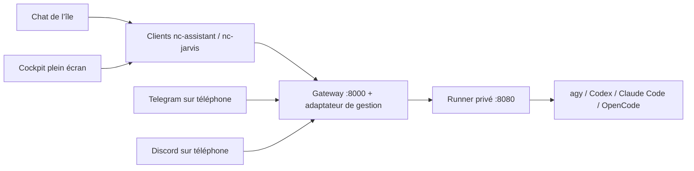

# JARVIS dans le bureau

Le chat de l’île et le cockpit plein écran utilisent la même conversation locale : agrandir, fermer le cockpit
ou revenir à l’île ne relance pas la question et ne perd pas le brouillon. Le logo animé reste celui fourni pour
l’assistant. Les appels passent par `nc-assistant` / `nc-jarvis`, jamais directement de QML vers le runner ou `agy`.

## Accès

- Île : Super + C, bulle de conversation ; bouton d’agrandissement pour le cockpit.
- Cockpit : **Super + Alt + A**, application **JARVIS**, ou `nc-jarvis tableau`.
- Retour au chat de l’île : `nc-jarvis ile`. F11 bascule plein écran/fenêtre ; Échap ferme le cockpit.
- **nc-settings → Agents IA (coucou)** : connexion, diagnostic, cockpit et déploiements local/SSH.
- Les commandes `nc-assistant ouvrir`, `chat`, `demander`, `briefing`, `verifier --json` restent compatibles.

Le cockpit natif utilise QtQuick et Quickshell, sans QtQuick.Controls, WebEngine, QtMultimedia ni module de capture.
Sur une installation sans Quickshell utilisable, le chat Kitty et les commandes restent disponibles ; le cockpit
natif demande Quickshell. `nc-jarvis console` donne aussi accès aux lectures de gestion depuis un terminal.
Le code est commun aux distributions prises en charge ; les tests de copie couvrent leurs familles, pas des
installations complètes sur des machines Fedora/Debian distinctes.

La page de l’île reprend l’orbe noir de `pfp.mp4`, ses anneaux cyan et une carte de réglages au-dessus de la
saisie. Le bouton de conversation en haut et le clic sur l’aperçu de réponse ouvrent l’historique complet,
y compris le détail des erreurs. Le badge « Prêt » signifie que la saisie est disponible, pas qu’une connexion
au serveur a été vérifiée. Pendant une demande, le bouton d’envoi indique l’attente ; il ne simule pas une
annulation que l’API ne propose pas. Les commandes vocales indiquent explicitement qu’elles ne sont pas
configurées : la dictée et la lecture vocale des bots mobiles ne constituent pas une intégration micro du bureau.
L’animation s’arrête quand la page, l’orbe ou le cockpit sont masqués, ainsi qu’en mode sans effets.

## Architecture et contrat vérifié

Référence examinée : [JARVIS-BIS](https://github.com/RaphaelBlanc/JARVIS-BIS/tree/8867dd093c43a5e5d3f0a13d3e14600e57edc96a),
notamment [le guide API](https://github.com/RaphaelBlanc/JARVIS-BIS/blob/8867dd093c43a5e5d3f0a13d3e14600e57edc96a/docs/NOCTALIA_API.md)
et le code de `gateway/main.py`, `home-runner/main.py` et `core/tools/dispatcher.py`.
Les anciennes notes `INTEGRATION_NOCTALIA.md` décrivent parfois des routes encore à créer : le code actuel prévaut.



Le chat fonctionne avec l’API d’origine (`POST /api/ask`). Les modules utilisent `POST /api/action`, les rappels
`/api/reminders`, le briefing `/api/briefing`. La gestion complète ajoute un petit adaptateur versionné
`POST /api/nc/manage` **dans le gateway** : il importe l’application originale et conserve ses routes, son cycle
de démarrage, le scheduler et les bots. Le client bureau ne contacte jamais le runner sur 8080.

L’adaptateur relaie uniquement les opérations prévues : modèles, session, conversations/historique, mémoire,
usage, configuration des modules/bots/briefing, état et journaux des services, redémarrages des deux services
utilisateur nommés. Il ne fournit ni chemin HTTP libre vers le runner, ni shell arbitraire.
L’ancien backend reste utilisable pour le chat ; le cockpit indique que l’adaptateur manque au lieu de simuler ses fonctions.

La route upstream `/api/stream` attend la réponse complète avant de la découper. Le client garde donc une attente
réelle puis la réponse complète ; il ne présente pas cette découpe comme une génération de tokens en direct.

## Déployer sur ce PC

Ouvrir **Déploiement → Déployer sur ce PC**, ou :

```sh
nc-jarvis deployer
```

Le terminal propose, séparément :

1. Le téléchargement de la révision examinée dans `~/.local/share/jarvis-bis` et deux venv Python, avec les
   fichiers de dépendances du dépôt d’origine. Python 3.11+, Git et le support `venv` sont nécessaires.
   Sur Debian/Ubuntu, un Python sans `venv` demande notamment le paquet `python3-venv`.
2. Les tokens Telegram/Discord et les IDs autorisés, puis la configuration facultative des modules.
   Les saisies secrètes sont masquées et une valeur vide conserve le token existant.
3. L’installation des services utilisateur `assistant-runner` et `assistant-gateway`, avec sauvegarde des
   unités existantes ; leur activation/démarrage est une proposition distincte.
4. La connexion client locale. Une connexion existante n’est remplacée qu’après choix explicite.

Les services utilisent les chemins réels, les venv du projet et le gateway enrichi `nc_gateway:app` et le runner `nc_runner:app`.
Ils écoutent sur **127.0.0.1:8000** et **127.0.0.1:8080**. Le CLI choisi doit être installé et authentifié sur l’hôte du runner ; cette authentification n’est pas fabriquée par l’intégration.

Le déploiement ne réinitialise pas un checkout existant : il refuse un autre dépôt, une révision différente ou des
modifications suivies. Les fichiers `.env` des composants gardent leurs valeurs propres ; les réglages changés sont
fusionnés. Les clés existantes divergentes demandent une harmonisation manuelle. Un modèle de clé `change_me…`
n’est pas considéré comme une clé à conserver. Les fichiers privés et leurs sauvegardes restent en mode 0600.
Si une unité JARVIS utilisateur pointe déjà vers un autre dossier, le déploiement s’arrête avant de télécharger :
réutiliser ce dossier avec `--path` après vérification du dépôt. Aucune migration automatique vers une base vierge.

## Déployer sur un serveur

Ouvrir **Déploiement → Déployer sur un serveur SSH**, ou :

```sh
nc-jarvis serveur
# équivalent avec la cible déjà choisie :
nc-jarvis deployer --serveur utilisateur@serveur
```

Le client transmet par SSH/SCP un bootstrap contenant seulement du code, **aucun token du PC**, puis lance le
même assistant en mode `server` dans le terminal SSH. Un alias de `~/.ssh/config` peut définir le port ou les
options SSH. Le serveur prépare son propre checkout, ses environnements et ses fichiers privés.
À la fin, il propose d’importer la connexion par SCP et de saisir l’URL HTTPS/VPN du gateway, sans afficher
sa clé. Une connexion client remplacée est sauvegardée. On peut aussi configurer ensuite manuellement
avec `nc-assistant configurer`. Le serveur conserve son fichier de transmission privé dans
`~/.local/state/nc-jarvis/connection.conf` (0600), exclu de l’export du bureau.

Pour que les services utilisateur restent actifs après déconnexion, un administrateur peut devoir activer
le maintien de session avec `loginctl enable-linger`. Un serveur allumé conserve l’accès mobile quand le PC
est éteint ; un backend installé uniquement sur le PC s’arrête quand celui-ci est éteint.

**Une seule instance de gateway par jeu de tokens de bots.** Préparer les deux parcours ne signifie pas démarrer
deux bots Telegram en polling avec le même token. Choisir l’hôte du backend existant pour conserver ses données.
Une installation de la config ou l’ouverture du cockpit ne démarre aucun backend.

Pour l’accès distant du bureau, suivre le [guide réseau JARVIS-BIS](https://github.com/RaphaelBlanc/JARVIS-BIS/blob/8867dd093c43a5e5d3f0a13d3e14600e57edc96a/docs/ACCES_DISTANT.md)
et son `scripts/expose-gateway.sh` : tunnel HTTPS vers le gateway, **jamais vers le runner**. Avec Tailscale et un
bind local, on peut par exemple utiliser Tailscale Serve comme proxy local ; accéder directement à une IP LAN/VPN
exige un bind et un pare-feu adaptés sur le serveur. Les tokens des bots et leurs whitelists restent ceux du backend.

## Matériel local et changement du dépôt upstream

La révision `8867dd0` renomme `render-gateway/` en `gateway/` et supprime le relais WebSocket PC-agent.
Les fonctions matérielles s’exécutent désormais sur **l’hôte de JARVIS**. Un serveur sans session graphique
ne pilote donc pas le bureau de ce PC. L’interface désactive ces actions en mode serveur ; le déploiement
local reste le parcours prévu pour piloter le bureau. La commande historique `nc-jarvis agent` explique
cette limite et n’installe aucun ancien relais.

Un backend existant sur une autre révision n’est pas réinitialisé ni déplacé automatiquement : le déployeur
s’arrête avant modification. Pour migrer une instance, sauvegarder ses données et fichiers privés et examiner
le renommage du dossier gateway, des chemins des services et de leurs venv avant de reprendre. Ne pas créer
un second backend avec les mêmes tokens pour contourner ce contrôle.

## Réglages rapides et moteurs

Le déployeur propose le moteur initial pour le parcours local comme pour SSH ; les choix enregistrés ensuite
dans l’interface restent prioritaires aux redémarrages.

Dans l’île, le bouton **réglages** ouvre le choix du **moteur, modèle et niveau de réflexion**, sans terminal.
**Actualiser** lit les capacités du runner ; **Appliquer** change la session partagée, y compris pour Telegram
et Discord. Les moteurs absents du runner sont grisés. Le bouton **Connexion…** ouvre la configuration privée.
La carte affiche au plus quatre modèles réellement annoncés par le runner, ou les quatre moteurs si aucun
catalogue n’a été reçu. Un clic prépare le choix dans les réglages ; seule l’action **Appliquer** l’enregistre.
Fermer les réglages abandonne les choix non appliqués. Les autres modèles et la saisie d’un identifiant restent
accessibles dans les réglages, sans imposer les noms de modèles des captures de référence.
Les deux adaptateurs doivent être présents : `nc_gateway:app` côté gateway, `nc_runner:app` côté runner.
Une API d’origine reste utilisable pour le chat ; elle n’annonce pas ces nouveaux réglages.

- **agy** conserve le bridge upstream, son worker et ses conversations natives.
- **Codex** utilise `codex exec`, reçoit le prompt sur stdin et lit les réponses JSONL. Les modèles et efforts
  disponibles sont repris du cache local du CLI **sur le runner**, quand il existe. Sinon, saisir l’identifiant
  exact ; l’authentification et les droits du compte sont vérifiés par le CLI lors de la demande.
- **Claude Code** utilise `claude --print --output-format json`, avec `--model` et `--effort`.
- **OpenCode** utilise `opencode run --format json --agent plan`. Un modèle se saisit sous la forme
  `provider/modèle#variante`, conformément au CLI installé. Aucune variante n’est inventée par le client.

Les trois nouveaux moteurs utilisent leurs protections habituelles (Codex en lecture seule, Claude/OpenCode
en mode plan), sans ajout de contournement d’approbation. Ils répondent aux chats ; des actions nécessitant
une autorisation interactive peuvent être refusées. Les outils explicites JARVIS passent toujours par son
catalogue et `/api/action`. Les CLI et leurs comptes doivent être installés/authentifiés sur l’hôte du runner ;
aucune installation de moteur ni copie d’identifiants n’est faite depuis l’île.

Pour ces trois moteurs, JARVIS conserve son propre historique privé, **distinct des sessions CLI personnelles**,
dans `home-runner/.nc-jarvis-engines.json` (0600) : au plus 30 conversations, 20 tours et 32 000 caractères
récents par conversation. La mémoire durable JARVIS est ajoutée à chaque demande. Changer de moteur conserve
les conversations de chacun ; **nouvelle conversation**, reprise et suppression visent le moteur actif.
Les préférences survivent au redémarrage du runner. Les tokens ne sont pas agrégés pour ces moteurs ; l’interface
l’indique. Il ne s’agit pas de sessions natives CLI à contexte illimité.

Les sous-processus sont sérialisés sur le runner, avec timeout et sorties bornées ; leur groupe est arrêté sur
échec ou dépassement. Aucune demande n’est rejouée automatiquement après erreur.

Le visuel de `pfp.mp4` apparaît sur fond noir au-dessus de la saisie : atlas QtQuick, sans dépendance codec.
Son animation s’arrête quand la page est cachée ou quand les effets sont désactivés. Les réglages sont chargés
à l’ouverture manuelle du panneau et à l’application, sans scrutation périodique.

## Gestion et extensions

Le registre du serveur fournit la liste des modules et leurs champs ; les secrets sont fournis en écriture seule,
avec un indicateur « déjà configuré ». Les réglages modifiés sont enregistrés dans les fichiers privés et ne prennent
effet qu’après redémarrage explicite des services. Les IDs de modèles viennent du runner.
Retirer un jeton Telegram/Discord est une action distincte avec confirmation ; vider un champ masqué ne le supprime pas.

Les actions bureau sont décrites dans `~/.local/share/nc-jarvis/actions.json`. Pour ajouter une action ou personnaliser
son formulaire sans perdre la modification lors des mises à jour, créer `~/.config/nc/jarvis-actions.json` :

```json
{
  "shopping": [
    {"id":"clear_done", "label":"Ranger les articles cochés", "fields":[]}
  ]
}
```

Les actions sont fusionnées par ID : un même ID remplace son formulaire, un nouvel ID s’ajoute. Un champ comporte
`key`, `label`, et éventuellement `kind: "number"` ou `secret: true`. Cela décrit une action **déjà implémentée par
le serveur** ; le catalogue n’invente pas une capacité. Un nouveau module peut fournir ses réglages sans exposer
d’action dans le dispatcher : le cockpit le précise. Aucun catalogue distant ne charge du code QML ou Python.
Les champs booléens des réglages ont un bouton activé/désactivé.

Les mutations présentent une confirmation avec leurs paramètres et masquent les valeurs secrètes.
L’envoi passe par stdin JSON : ni token ni paramètres privés dans les arguments du processus.
Le suivi d’activité réutilise les verrous de `nc-claude` ; les requêtes mutantes du même PC sont sérialisées par identité.

## Limites à connaître

- **Session globale actuelle** : le code JARVIS-BIS partage la session moteur entre bureau, Telegram et Discord.
  Changer de modèle, reprendre ou réinitialiser une conversation affecte les autres interfaces. La mémoire durable
  est également partagée. Le cockpit l’indique ; il ne revendique pas une isolation inexistante.
- Le serveur upstream marque les rappels `desktop` comme traités après les avoir seulement journalisés. Le cockpit
  propose donc Telegram/Discord pour une livraison effective ; il n’invente pas un flux d’événements bureau fiable.
- Le verrou du PC ne coordonne pas les autres appareils. Aucune requête n’est rejouée automatiquement après une
  coupure : le moteur peut continuer à la traiter.
- « Bot configuré » indique un token présent, pas la réception vérifiée d’un message mobile.
- Les services gérés sont les **services utilisateur du gateway**. Une installation en services système root demande son propre mode de gestion ; le cockpit ne l’assimile pas à `systemctl --user`.
- Le chat local reste borné en RAM (24 messages, 48 000 caractères) et disparaît au redémarrage de l’île.
  Les conversations persistantes du moteur sont consultables séparément dans le cockpit.

## Vérifications

Les tests isolent HOME et l’API : authentification de l’adaptateur, confirmation, chemins autorisés, préservation et
rollback des réglages, masquage des secrets, services à écoute locale, bootstrap SSH sans secrets, échanges du vrai
client avec un faux gateway, états de l’île, copie sur les familles de distributions et navigation QML hors écran.
Les tests de l’adaptateur demandent FastAPI/httpx/python-dotenv dans un **venv de test**, pas sur le client utilisateur.
Le test de contrat opt-in `NC_JARVIS_UPSTREAM=/chemin/JARVIS-BIS` charge le vrai runner et le forward du gateway,
avec HOME temporaire et faux CLI ; il ne contacte ni modèle ni bot.

```sh
python3 -B -m unittest discover -s tests -q
# Avec les dépendances API dans un venv de test :
/path/venv/bin/python -B -m unittest discover -s tests -q
```

Restent nécessaires sur un backend réellement déployé : authentification de chaque CLI, réponse modèle, réception Telegram
et Discord depuis le téléphone, livraison d’un rappel mobile, accès HTTPS/VPN, reconnexion du relais matériel et
redémarrage après boot. Les tests simulés ne constituent pas cette validation en production.

Options des CLI vérifiées dans leur aide installée et les références officielles : [Codex](https://developers.openai.com/codex/cli/reference/), [Claude Code](https://code.claude.com/docs/en/cli-reference), [OpenCode](https://opencode.ai/docs/cli/).
